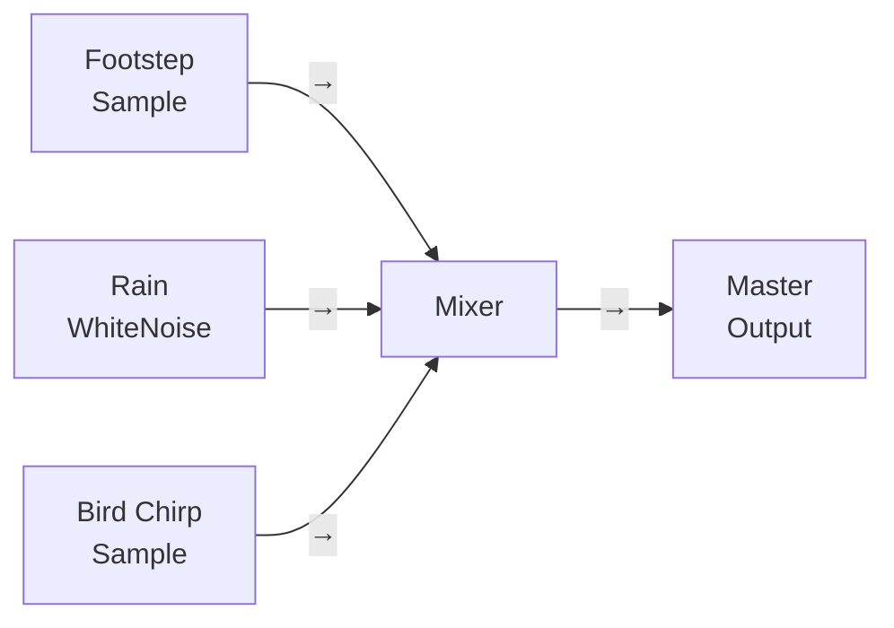
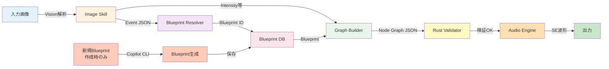
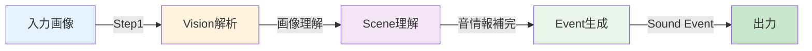
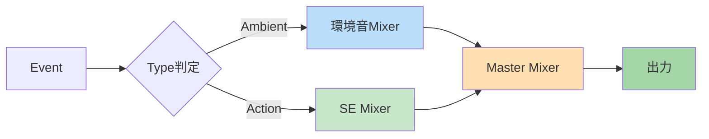
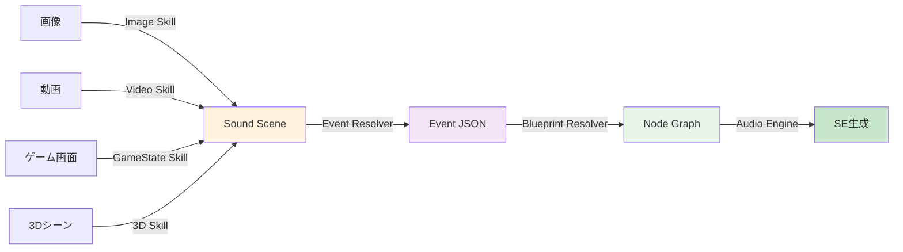

# Eventスキーマを設計

Event は単なる「雨」「爆発」ではなく、

**Graph Builderがそのままノード構成を組み立てられるレベルの音響イベント**

として設計すると後々強いです。

---

## 3層構造アーキテクチャ

```
Scene
  └─ Event
       └─ Sound Source
```

| 層 | 役割 | 例 |
|-----|------|-----|
| **Scene** | 環境・背景情報 | 森、雨、夜間、張り詰めた雰囲気 |
| **Event** | 音響イベント | 足音、爆発、銃声 |
| **Sound Source** | 生成方法 | Noise Generator、Oscillator、Sample |

---

## **Blueprint** とは

あなたの設計における **Blueprint** は、

> **「Event から実際のノードグラフを生成するための設計図（テンプレート）」**

です。

### 例

Event が

```json
{
  "type": "rain",
  "intensity": 0.8
}
```

だった場合、直接ノードを作るのではなく、まず

```json
{
  "id": "rain_v1"
}
```

という **Blueprint** を選びます。

---

## 建築で例えると

```
Event
  ↓
「木造2階建ての家」

Blueprint
  ↓
設計図

Graph
  ↓
実際の家
```

SE生成では

```
Event
  ↓
「雨」

Blueprint（音響レシピ）
  ↓
雨の回路テンプレート

Graph（ノードグラフ）
  ↓
実際のノード構成
```

---

## 具体例

**入力 Event:**

```json
{
  "type": "rain"
}
```

**選択される Blueprint:**

```json
{
  "id": "rain_v1",
  "nodes": [
    {
      "id": "noise",
      "type": "WhiteNoise"
    },
    {
      "id": "filter",
      "type": "LowPass"
    },
    {
      "id": "gain",
      "type": "Gain"
    }
  ],
  "connections": [
    ["noise", "filter"],
    ["filter", "gain"]
  ]
}
```

**Graph Builder による展開:**

```
WhiteNoise
  ↓
LowPass
  ↓
Gain
  ↓
Output
```

---

## なぜ Blueprint が必要か

もし Blueprint がないと、毎回 AI が

```
雨とは何か？
  ↓
どういうノード構成か？
  ↓
フィルタは必要か？
  ↓
Reverb は？
```

を考える必要があります。

**結果:** 同じ雨なのに **毎回違う Graph** になる ❌

---

**Blueprint があると**

```
rain        → rain_v1
footstep    → footstep_grass_v1
explosion   → explosion_large_v1
```

と **固定できます** ✅

---

## あなたのシステム全体図

```
画像
  ↓
Vision AI
  ↓
Scene JSON

テキスト
  ↓
LLM
  ↓
Scene JSON

Scene JSON（統一形式）
  ↓
SoundEvent生成 Skill（ルール）
  ↓
Event JSON

Event JSON
  ↓
Blueprint Resolver（テーブル検索）
  ↓
Blueprint JSON（音響レシピ）

Blueprint JSON
  ↓
Graph Builder
  ↓
Node Graph

Node Graph
  ↓
Audio Engine
  ↓
PCM 波形
```

**重要:** AI は Scene 解析と Event 生成まで。**その後は完全にルールベース** ✅

---

## SFXGraph における 3つの JSON 型

### 1. Scene JSON（環境情報）

Vision AI または LLM の出力。

```json
{
  "scene": {
    "location": "forest",
    "environment": "outdoor",
    "weather": "rain",
    "surface": "grass"
  },
  "actors": [
    {
      "type": "human",
      "action": "running",
      "movement": 0.9
    }
  ],
  "objects": [
    {
      "type": "river"
    }
  ]
}
```

**生成者:** Vision AI / LLM  
**消費者:** SoundEvent生成 Skill  
**再現性:** △（AI依存）

---

### 2. Event JSON（音響イベント）

SoundEvent生成 Skill の出力。

```json
{
  "version": "1.0",
  "ambientEvents": [
    {
      "id": "rain_001",
      "type": "rain",
      "category": "weather",
      "intensity": 0.7,
      "blueprintHint": "rain_v1"
    }
  ],
  "actionEvents": [
    {
      "id": "footstep_001",
      "type": "footstep",
      "category": "human",
      "tags": ["grass", "wet", "running"],
      "intensity": 0.9,
      "importance": 1.0,
      "blueprintHint": "footstep_grass_wet"
    }
  ]
}
```

**生成者:** SoundEvent生成 Skill（ルール）  
**消費者:** Blueprint Resolver  
**再現性:** ✅（ルールベース）

---

### 3. Blueprint JSON（音響レシピ）

ノード構成の「テンプレート」。

```json
{
  "id": "footstep_grass_v1",
  "name": "Grass Footstep",
  "category": "human",
  "version": "1.0",
  "nodes": [
    {
      "id": "sample",
      "type": "SamplePlayer",
      "parameters": {
        "asset": "footstep_grass.wav"
      }
    },
    {
      "id": "eq",
      "type": "EQ"
    },
    {
      "id": "gain",
      "type": "Gain"
    }
  ],
  "connections": [
    ["sample", "eq"],
    ["eq", "gain"]
  ],
  "parameterMappings": [
    {
      "eventField": "intensity",
      "nodeId": "gain",
      "parameter": "gain",
      "min": 0.2,
      "max": 1.0
    }
  ]
}
```

**生成者:** Blueprint Resolver / Copilot CLI  
**消費者:** Graph Builder  
**再現性:** ✅（テンプレート化）

---

## 「音響レシピ」という考え方

```
Scene
  ↓
Event
  ↓
Blueprint（音響レシピ）
  ↓
Graph
  ↓
Audio
```

**比喩:**

| 要素 | 料理 | SE生成 |
|------|------|---------|
| Scene | 食材の種類・状態 | 環境・背景情報 |
| Event | 「カレーを作る」 | 「足音を生成する」 |
| Blueprint | レシピ本 | ノード構成テンプレート |
| Graph | 実際の調理手順 | 実際のノード接続 |
| Audio | 完成した料理 | 生成された波形 |

---

## 責務の明確な分離

```
AI の役割
├─ Scene 解析（画像・テキスト）
└─ Event 生成（ルール）

ルールベース
├─ Blueprint 選択（テーブル検索）
└─ Graph 生成（AST展開）

Copilot CLI
└─ 新規 Blueprint 作成（1回のみ）
```

---

## Copilot と の協働

**Copilot CLI を使う場合:**

```
① Event 生成
   → SoundEvent生成 Skill（完全自動化、再利用可能）

② Blueprint 作成
   → Copilot CLI（新規 Event type 追加時のみ）
   → 自動生成 → Rust 検証 → DB登録

③ Graph 生成
   → ルールベース（毎回同じ結果、高速）
```

**メリット:**

```
✅ Skill は安定（ルール）
✅ Blueprint は柔軟（Copilot生成後は固定）
✅ Graph 生成は高速（< 100ms）
✅ 全体の再現性◎
```

---

## Blueprint と NodeGraph の違いを整理

**重要:** これはシステム設計上、かなり重要な区別です。

実は、あなたの設計だと **Blueprint と NodeGraph は別物として扱った方がよいケース** と、**同一視してもよいケース** があります。

---

## 一言でいうと

### Blueprint

> 音を作るための「**設計図**」

### NodeGraph

> 実際に実行する「**インスタンス**」

---

## 建築で例える

```
Blueprint
  = 住宅の設計図

NodeGraph
  = 実際に建てた家
```

同じ設計図でも、

```
Aさんの家（NodeGraph_A）
Bさんの家（NodeGraph_B）
Cさんの家（NodeGraph_C）
```

は別の実体になります。

---

## あなたのシステムで置き換える

### Event

```json
{
  "type": "footstep",
  "tags": ["grass"],
  "intensity": 0.8
}
```

### Blueprint

```json
{
  "id": "footstep_grass_v1",
  "nodes": [
    {
      "id": "sample",
      "type": "SamplePlayer"
    },
    {
      "id": "gain",
      "type": "Gain"
    }
  ],
  "connections": [
    ["sample", "gain"]
  ]
}
```

**特徴:** テンプレート。実値（volume, gain等）は **持たない**。

### NodeGraph

```json
{
  "instanceId": "graph_001",
  "nodes": [
    {
      "id": "sample",
      "type": "SamplePlayer",
      "asset": "footstep_grass.wav"
    },
    {
      "id": "gain",
      "type": "Gain",
      "gain": 0.82
    }
  ],
  "connections": [
    ["sample", "gain"]
  ]
}
```

**特徴:** 実体。Event から値が **反映済み**。

---

## Blueprint の特徴

Blueprint はテンプレートです。

```json
{
  "id": "rain_v1",
  "nodes": [
    {
      "type": "NoiseGenerator"
    },
    {
      "type": "LowPass"
    },
    {
      "type": "Gain"
    }
  ]
}
```

ここには以下が **ない**：

```
- frequency（4200Hz等の実値）
- gain（0.74等の実値）
- intensity（0.5等の実値）
```

---

## NodeGraph の特徴

NodeGraph は実体です。

```json
{
  "nodes": [
    {
      "type": "NoiseGenerator",
      "seed": 12345
    },
    {
      "type": "LowPass",
      "frequency": 4200
    },
    {
      "type": "Gain",
      "gain": 0.74
    }
  ]
}
```

Event から値が反映済みです。

---

## なぜ分ける必要があるのか

例えば、**同じ雨でも**

**弱い雨:**

```json
{
  "type": "rain",
  "intensity": 0.2
}
```

**豪雨:**

```json
{
  "type": "rain",
  "intensity": 1.0
}
```

の場合、

**Blueprint は同じです。**

```
rain_v1（同じ設計図）
```

しかし **NodeGraph は違います。**

**弱い雨（NodeGraph_A）:**

```json
{
  "instanceId": "rain_weak_001",
  "nodes": [
    {
      "type": "Gain",
      "gain": 0.2
    }
  ]
}
```

**豪雨（NodeGraph_B）:**

```json
{
  "instanceId": "rain_heavy_001",
  "nodes": [
    {
      "type": "Gain",
      "gain": 1.0
    }
  ]
}
```

---

## 処理フロー（詳細版）

```
Event
  │
  ├─ type: "rain"
  ├─ intensity: 0.2
  └─ tags: ["outdoor"]

  ↓ Blueprint Resolver（テーブル検索）

Blueprint: rain_v1
  │
  ├─ nodes: [NoiseGenerator, LowPass, Gain]
  └─ parameterMappings:
     └─ { eventField: "intensity",
          nodeId: "gain",
          parameter: "gain",
          min: 0.0,
          max: 1.0 }

  ↓ Graph Builder（Parameter Mapping 適用）

NodeGraph_weak_001
  │
  ├─ nodes: [
       { type: NoiseGenerator, seed: 12345 },
       { type: LowPass, frequency: 4200 },
       { type: Gain, gain: 0.2 }  ← intensity値が反映
     ]
  └─ connections: [...]

  ↓ Audio Engine（実行）

PCM 波形（弱い雨の音）
```

---

## おすすめの設計構成

**あなたのシステムの場合:**

```
Scene
  ↓
Event（intensity, duration等の制御値）
  ↓
Blueprint（ノード構造テンプレート）
  │
  └─ 「どんな回路にするか」を決定
  
  ↓ Graph Builder
  
NodeGraph（パラメータ付きの実行可能グラフ）
  │
  └─ 「実際のパラメータ値を計算」
  
  ↓ Audio Engine
  
PCM 波形（生成された音）
```

---

## 分離のメリット

| メリット | 説明 |
|---------|------|
| **テストしやすい** | Blueprint は設計のみ。値の変換は Parameter Mapping でテスト |
| **再利用可能** | 同じ Blueprint で複数の intensity 値に対応 |
| **キャッシュ可能** | Blueprint は固定なので、キャッシュして再利用可能 |
| **バージョン管理** | Blueprint のバージョン（v1, v2等）を管理しやすい |
| **複数インスタンス化** | 同じ Blueprint から複数の NodeGraph を生成可能 |

---

## ただし小規模なら分けなくてもよい

システムが小規模な場合、Blueprint と NodeGraph を分けなくてもいいです。

例えば

```json
{
  "id": "footstep_grass",
  "nodes": [...]
}
```

を直接 Graph として使う。

**ただし、このアプローチの欠点:**

```
❌ Parameter Mapping の仕組みが使えない
❌ 複数 intensity に対応するたびに新規 Blueprint 必要
❌ 拡張しづらい
```

---

## 個人的なおすすめ

あなたの構想は

```
- Image Skill
- Event Skill
- Blueprint Resolver
- Copilot CLI
- Rust Audio Engine
```

ここまで考えているので、

**Blueprint = ノード構造テンプレート**  
**NodeGraph = 実行用インスタンス**

に分離した方が拡張しやすいです。

つまり最終的には、

```
Scene
  ↓
Event
  ↓
Blueprint
  （どんな回路にするか）
  ↓
NodeGraph
  （実際のパラメータ入り回路）
  ↓
Audio Engine
```

という責務分離が最も綺麗な設計になります。

---

## まとめ表

| 層 | 名称 | 役割 | テンプレート? | 実値? | 生成者 |
|-----|------|------|-----------|--------|---------|
| **1** | Event | 制御値 | ✅ | ✅ | Skill |
| **2** | Blueprint | ノード構造 | ✅ | ❌ | Resolver |
| **3** | NodeGraph | 実行グラフ | ❌ | ✅ | Graph Builder |
| **4** | Audio | 波形 | ❌ | ✅ | Audio Engine |

## まとめ表

| 層 | 名称 | 役割 | テンプレート? | 実値? | 生成者 |
|-----|------|------|-----------|--------|---------|
| **1** | Event | 制御値 | ✅ | ✅ | Skill |
| **2** | Blueprint | ノード構造 | ✅ | ❌ | Resolver |
| **3** | NodeGraph | 実行グラフ | ❌ | ✅ | Graph Builder |
| **4** | Audio | 波形 | ❌ | ✅ | Audio Engine |

**重要な違い:**

```
Event    = 「何をするか」の指示
Blueprint = 「どうするか」の設計
NodeGraph = 「実行する」ための完全な定義
Audio    = 「結果」
```

---

## Blueprint Schema v1

あなたの構成なら、Blueprint は **「音響レシピのテンプレート」** なので、設計上以下のルールで統一するのがおすすめです。

```
✅ ノード構造のみ定義
✅ Event→Parameter のマッピングを持つ（Modifier）
❌ Event は含まない
❌ 実行時パラメータは含まない（gain=0.83等）
```

---

### JSON Schema 2020-12 形式

```json
{
  "$schema": "https://json-schema.org/draft/2020-12/schema",
  "$id": "blueprint.schema.json",
  "title": "Audio Blueprint",
  "type": "object",
  "required": [
    "id",
    "version",
    "name",
    "nodes",
    "connections"
  ],
  "properties": {
    "id": {
      "type": "string",
      "description": "一意のBlueprint ID"
    },
    "version": {
      "type": "string",
      "description": "Schema version（1.0等）"
    },
    "name": {
      "type": "string",
      "description": "人間が読める名前"
    },
    "description": {
      "type": "string",
      "description": "Blueprint の説明"
    },
    "category": {
      "type": "string",
      "description": "カテゴリ（human, weather, weapon等）"
    },
    "tags": {
      "type": "array",
      "items": { "type": "string" },
      "description": "検索用タグ"
    },
    "loopable": {
      "type": "boolean",
      "default": false,
      "description": "ループ可能（環境音）かどうか"
    },
    "nodes": {
      "type": "array",
      "items": { "$ref": "#/$defs/Node" },
      "description": "ノード定義"
    },
    "connections": {
      "type": "array",
      "items": { "$ref": "#/$defs/Connection" },
      "description": "ノード間の接続"
    },
    "modifiers": {
      "type": "array",
      "items": { "$ref": "#/$defs/Modifier" },
      "description": "Event→Parameter マッピング"
    }
  },
  "$defs": {
    "Node": {
      "type": "object",
      "required": ["id", "type"],
      "properties": {
        "id": {
          "type": "string",
          "description": "ノードの一意ID"
        },
        "type": {
          "type": "string",
          "description": "ノードタイプ（Oscillator, Filter等）"
        },
        "parameters": {
          "type": "object",
          "additionalProperties": true,
          "description": "静的パラメータ（frequency=5000等）"
        }
      }
    },
    "Connection": {
      "type": "object",
      "required": ["source", "target"],
      "properties": {
        "source": {
          "type": "string",
          "description": "接続元ノードID"
        },
        "target": {
          "type": "string",
          "description": "接続先ノードID"
        },
        "sourcePort": {
          "type": "string",
          "description": "接続元ポート名（audio, control等）"
        },
        "targetPort": {
          "type": "string",
          "description": "接続先ポート名"
        }
      }
    },
    "Modifier": {
      "type": "object",
      "required": ["eventField", "nodeId", "parameter"],
      "properties": {
        "eventField": {
          "type": "string",
          "description": "Event のどのフィールドを使うか（intensity, duration等）"
        },
        "nodeId": {
          "type": "string",
          "description": "対象ノードID"
        },
        "parameter": {
          "type": "string",
          "description": "対象パラメータ（gain, frequency等）"
        },
        "mapping": {
          "type": "string",
          "enum": ["linear", "log", "curve", "enum"],
          "description": "変換方式"
        },
        "min": {
          "type": "number",
          "description": "出力最小値"
        },
        "max": {
          "type": "number",
          "description": "出力最大値"
        }
      }
    }
  }
}
```

---

## 雨の Blueprint（実例）

```json
{
  "id": "rain_v1",
  "version": "1.0",
  "name": "Rain",
  "category": "weather",
  "loopable": true,
  "nodes": [
    {
      "id": "noise",
      "type": "WhiteNoise"
    },
    {
      "id": "filter",
      "type": "LowPass",
      "parameters": {
        "frequency": 5000
      }
    },
    {
      "id": "gain",
      "type": "Gain"
    },
    {
      "id": "out",
      "type": "Output"
    }
  ],
  "connections": [
    {
      "source": "noise",
      "target": "filter"
    },
    {
      "source": "filter",
      "target": "gain"
    },
    {
      "source": "gain",
      "target": "out"
    }
  ],
  "modifiers": [
    {
      "eventField": "intensity",
      "nodeId": "gain",
      "parameter": "gain",
      "mapping": "linear",
      "min": 0.1,
      "max": 1.0
    }
  ]
}
```

**重要ポイント:**

```
❌ gain の実値（0.83等）は入っていない
✅ Modifier で「intensity 値を gain に線形写像」と定義されている
✅ 実際の値は NodeGraph 生成時に計算される
```

---

## 足音 Blueprint（実例）

```json
{
  "id": "footstep_base_v1",
  "version": "1.0",
  "name": "Footstep",
  "category": "human",
  "nodes": [
    {
      "id": "sample",
      "type": "SamplePlayer"
    },
    {
      "id": "eq",
      "type": "EQ"
    },
    {
      "id": "gain",
      "type": "Gain"
    },
    {
      "id": "out",
      "type": "Output"
    }
  ],
  "connections": [
    {
      "source": "sample",
      "target": "eq"
    },
    {
      "source": "eq",
      "target": "gain"
    },
    {
      "source": "gain",
      "target": "out"
    }
  ],
  "modifiers": [
    {
      "eventField": "intensity",
      "nodeId": "gain",
      "parameter": "gain",
      "mapping": "linear",
      "min": 0.2,
      "max": 1.0
    }
  ]
}
```

---

## Blueprint と NodeGraph の差分

### Blueprint（テンプレート）

```json
{
  "id": "rain_v1",
  "nodes": [
    {
      "id": "noise",
      "type": "WhiteNoise"
    },
    {
      "id": "gain",
      "type": "Gain"
    }
  ],
  "modifiers": [
    {
      "eventField": "intensity",
      "nodeId": "gain",
      "parameter": "gain",
      "mapping": "linear",
      "min": 0.1,
      "max": 1.0
    }
  ]
}
```

**特徴:**
```
✅ ノード構造のみ
✅ Modifier で マッピングルール定義
❌ 実値なし
```

### NodeGraph（実行時インスタンス）

```json
{
  "instanceId": "graph_001",
  "nodes": [
    {
      "id": "noise",
      "type": "WhiteNoise",
      "parameters": {
        "seed": 12345
      }
    },
    {
      "id": "gain",
      "type": "Gain",
      "parameters": {
        "gain": 0.83
      }
    }
  ]
}
```

**特徴:**
```
✅ 全パラメータが具体値で埋まっている
✅ Audio Engine が直接実行可能
❌ Modifier は不要（値は既に計算済み）
```

---

## 処理フロー（Event → NodeGraph）

```
入力 Event
  │
  ├─ type: "rain"
  ├─ intensity: 0.8
  └─ tags: ["outdoor"]

  ↓ Blueprint Resolver（テーブル検索）
  
選択 Blueprint: rain_v1
  │
  ├─ nodes: [WhiteNoise, LowPass, Gain, Output]
  ├─ modifiers: [
       {
         eventField: "intensity",
         nodeId: "gain",
         parameter: "gain",
         mapping: "linear",
         min: 0.1,
         max: 1.0
       }
     ]
  └─ connections: [...]

  ↓ Graph Instantiator
  （Modifier 適用：intensity 0.8 → gain 0.8 計算）

生成 NodeGraph: graph_rain_001
  │
  ├─ nodes: [
       { type: WhiteNoise, seed: 12345 },
       { type: LowPass, frequency: 5000 },
       { type: Gain, gain: 0.8 }  ← 計算済み
       { type: Output }
     ]
  └─ connections: [...]

  ↓ Audio Engine（実行）

出力 PCM 波形（強い雨の音）
```

---

## Blueprint は Git 管理する静的アセット

あなたの Image → Event → Graph 構成なら：

```
Blueprint
  ├─ Git 管理（バージョン履歴）
  ├─ 静的アセット
  ├─ Copilot CLI で生成
  ├─ Rust バリデーション後に登録
  └─ 再利用可能

NodeGraph
  ├─ 実行時生成
  ├─ 一時成果物
  ├─ Graph Instantiator で生成
  └─ 破棄可能
```

**フローイメージ:**

```
コード管理層（Git）
├─ Blueprint DB
│  ├─ rain_v1 ✅
│  ├─ footstep_grass_v1 ✅
│  └─ explosion_large_v1 ✅
└─ Modifier テーブル

実行時層（メモリ）
├─ Event JSON
├─ NodeGraph インスタンス
└─ Audio PCM バッファ
```

---

## Schema フィールド説明

| フィールド | 型 | 必須 | 説明 | 例 |
|-----------|-----|------|------|-----|
| **id** | string | ✅ | 一意ID | "rain_v1" |
| **version** | string | ✅ | スキーマバージョン | "1.0" |
| **name** | string | ✅ | 人間が読める名前 | "Rain" |
| **category** | string | - | カテゴリ | "weather" |
| **loopable** | boolean | - | ループ可能 | true |
| **nodes** | array | ✅ | ノード配列 | [{id, type}] |
| **connections** | array | ✅ | 接続配列 | [{source, target}] |
| **modifiers** | array | - | Event→Param マッピング | [{eventField, nodeId}] |

---

## Modifier フィールド説明

| フィールド | 型 | 説明 | 例 |
|-----------|-----|------|-----|
| **eventField** | string | Event のどのフィールド | "intensity", "duration" |
| **nodeId** | string | 対象ノードID | "gain", "filter" |
| **parameter** | string | 対象パラメータ | "gain", "frequency" |
| **mapping** | enum | 変換方式 | "linear", "log", "curve" |
| **min** | number | 出力最小値 | 0.1 |
| **max** | number | 出力最大値 | 1.0 |

**mapping の種類:**

```
linear  → intensity 0.0-1.0 → gain 0.1-1.0 直線変換
log     → 対数スケール（周波数等）
curve   → 任意曲線（別途 LUT定義）
enum    → 離散値マッピング（タグ等）
```

---

## まとめ

```
Blueprint
  = 「音響レシピの設計図」
  = テンプレート
  = Git 管理
  = Modifier で Event マッピング定義
  = 再利用可能

NodeGraph
  = 「実行時に生成されたグラフ」
  = インスタンス
  = メモリ内
  = 全パラメータが具体値
  = Audio Engine が実行可能
```

この分離により：

```
✅ Blueprint は設計と再利用に専念
✅ NodeGraph は実行時の効率に専念
✅ Modifier は変換ロジックを明示
✅ 保守性と拡張性◎
```

---

## Schema に入力と出力ポートを追加

より正式な設計にするなら、`Connection` が文字列参照ではなく **Port ID 同士を接続**する設計がおすすめです。

```
Blueprint
 ├─ Nodes
 │  ├─ InputPorts
 │  └─ OutputPorts
 │
 └─ Connections
    ├─ sourceNode
    ├─ sourcePort
    ├─ targetNode
    └─ targetPort
```

こうすると将来的に以下の信号種別に対応できます：

```
audio    → 音声ストリーム
control  → 値（Frequency, Gain等）
trigger  → NoteOn, Play等
event    → アプリケーションイベント
```

---

## Port Schema

入出力ポートの定義。

```json
{
  "$defs": {
    "Port": {
      "type": "object",
      "required": [
        "id",
        "name",
        "direction",
        "signalType"
      ],
      "properties": {
        "id": {
          "type": "string",
          "description": "ポートの一意ID"
        },
        "name": {
          "type": "string",
          "description": "人間が読める名前"
        },
        "direction": {
          "type": "string",
          "enum": ["input", "output"],
          "description": "入力 or 出力"
        },
        "signalType": {
          "type": "string",
          "enum": ["audio", "control", "trigger", "event"],
          "description": "信号の種類"
        },
        "multiple": {
          "type": "boolean",
          "default": false,
          "description": "複数接続可能か"
        },
        "description": {
          "type": "string",
          "description": "ポートの説明"
        }
      }
    }
  }
}
```

---

## Node Schema（ポート対応版）

```json
{
  "$defs": {
    "Node": {
      "type": "object",
      "required": ["id", "type"],
      "properties": {
        "id": {
          "type": "string",
          "description": "ノードの一意ID"
        },
        "type": {
          "type": "string",
          "description": "ノードタイプ"
        },
        "displayName": {
          "type": "string",
          "description": "UI表示用の名前"
        },
        "inputPorts": {
          "type": "array",
          "items": { "$ref": "#/$defs/Port" },
          "description": "入力ポートの配列"
        },
        "outputPorts": {
          "type": "array",
          "items": { "$ref": "#/$defs/Port" },
          "description": "出力ポートの配列"
        },
        "parameters": {
          "type": "object",
          "additionalProperties": true,
          "description": "静的パラメータ"
        }
      }
    }
  }
}
```

---

## Connection Schema（ポート対応版）

```json
{
  "$defs": {
    "Connection": {
      "type": "object",
      "required": [
        "sourceNode",
        "sourcePort",
        "targetNode",
        "targetPort"
      ],
      "properties": {
        "sourceNode": {
          "type": "string",
          "description": "接続元ノードID"
        },
        "sourcePort": {
          "type": "string",
          "description": "接続元ポートID"
        },
        "targetNode": {
          "type": "string",
          "description": "接続先ノードID"
        },
        "targetPort": {
          "type": "string",
          "description": "接続先ポートID"
        }
      }
    }
  }
}
```

---

## Oscillator の例

```json
{
  "id": "osc1",
  "type": "Oscillator",
  "displayName": "Oscillator 1",
  "inputPorts": [
    {
      "id": "freq",
      "name": "Frequency",
      "direction": "input",
      "signalType": "control",
      "description": "周波数制御"
    },
    {
      "id": "gate",
      "name": "Gate",
      "direction": "input",
      "signalType": "trigger",
      "description": "ノートオン/オフ"
    }
  ],
  "outputPorts": [
    {
      "id": "audio",
      "name": "Audio",
      "direction": "output",
      "signalType": "audio",
      "description": "オシレーター出力"
    }
  ]
}
```

---

## Gain の例

```json
{
  "id": "gain1",
  "type": "Gain",
  "displayName": "Main Gain",
  "inputPorts": [
    {
      "id": "audioIn",
      "name": "Audio In",
      "direction": "input",
      "signalType": "audio",
      "description": "音声入力"
    },
    {
      "id": "gainControl",
      "name": "Gain Control",
      "direction": "input",
      "signalType": "control",
      "description": "ゲイン制御（0.0-1.0）"
    }
  ],
  "outputPorts": [
    {
      "id": "audioOut",
      "name": "Audio Out",
      "direction": "output",
      "signalType": "audio",
      "description": "音声出力"
    }
  ]
}
```

---

## Connection の例

**Oscillator の audio ポート → Gain の audioIn ポートに接続:**

```json
{
  "sourceNode": "osc1",
  "sourcePort": "audio",
  "targetNode": "gain1",
  "targetPort": "audioIn"
}
```

---

## Footstep Blueprint 例（ポート対応版）

```json
{
  "id": "footstep_grass_v1",
  "version": "1.0",
  "name": "Footstep",
  "category": "human",
  "nodes": [
    {
      "id": "sample",
      "type": "SamplePlayer",
      "displayName": "Sample Player",
      "outputPorts": [
        {
          "id": "audio",
          "name": "Audio",
          "direction": "output",
          "signalType": "audio"
        }
      ]
    },
    {
      "id": "gain",
      "type": "Gain",
      "displayName": "Gain",
      "inputPorts": [
        {
          "id": "audioIn",
          "name": "Audio In",
          "direction": "input",
          "signalType": "audio"
        }
      ],
      "outputPorts": [
        {
          "id": "audioOut",
          "name": "Audio Out",
          "direction": "output",
          "signalType": "audio"
        }
      ]
    },
    {
      "id": "output",
      "type": "Output",
      "displayName": "Output",
      "inputPorts": [
        {
          "id": "audio",
          "name": "Audio",
          "direction": "input",
          "signalType": "audio"
        }
      ]
    }
  ],
  "connections": [
    {
      "sourceNode": "sample",
      "sourcePort": "audio",
      "targetNode": "gain",
      "targetPort": "audioIn"
    },
    {
      "sourceNode": "gain",
      "sourcePort": "audioOut",
      "targetNode": "output",
      "targetPort": "audio"
    }
  ],
  "modifiers": [
    {
      "eventField": "intensity",
      "nodeId": "gain",
      "parameter": "gain",
      "mapping": "linear",
      "min": 0.2,
      "max": 1.0
    }
  ]
}
```

---

## signalType の重要性

将来的に Rust の Audio Engine を作るなら、`signalType` を最初から分けておくのがおすすめです。

```
audio    → 音声ストリーム（PCM、44.1kHz等）
           複数を並行処理・Mixer統合
           
control  → 値の流れ（Frequency, Gain等）
           0.0-1.0の正規化スカラー
           
trigger  → パルス/イベント（NoteOn, Play, Stop等）
           時間情報を持つ
           
event    → アプリケーションイベント
           曲名変更、UI更新等
```

**この設計にしておくと：**

```
❌ 後で LFO、Envelope、MIDI、Automation を追加したい
   → Schema を修正する必要があるか？

✅ No! signalType が既に設計されているので
   LFO の出力を control ポートに接続
   MIDI input を trigger ポートに接続
   するだけで対応できます
```

---

## ポート対応設計のメリット

| メリット | 説明 |
|---------|------|
| **型安全性** | 異なる signalType は接続不可（バリデーション可能） |
| **拡張性** | 新規 signalType 追加時に Node 定義不要 |
| **複雑な接続** | audio 複数出力→Mixer 等の構成が明示的 |
| **実行時検証** | Audio Engine が接続妥当性をチェック可能 |
| **UI表示** | ポートの視覚的表現（色分け等）が可能 |

---

## Rust Audio Engine での実装例（疑似コード）

```rust
enum PortType {
    Audio,
    Control,
    Trigger,
    Event,
}

struct Port {
    id: String,
    signal_type: PortType,
    direction: Direction,
}

struct Connection {
    source_node: String,
    source_port: String,
    target_node: String,
    target_port: String,
}

impl Connection {
    fn validate(&self, blueprint: &Blueprint) -> Result<()> {
        // ポート型の一致確認
        let source_type = blueprint.get_port(&self.source_node, &self.source_port)?
            .signal_type;
        let target_type = blueprint.get_port(&self.target_node, &self.target_port)?
            .signal_type;
        
        // 同じ型のみ接続可能
        if source_type == target_type {
            Ok(())
        } else {
            Err("ポート型が一致しません")
        }
    }
}
```

---

## 信号の流れ（概念図）

```
                   ┌─────────────┐
                   │ Oscillator  │
              ┌────┤   (audio)   ├────┐
              │    └─────────────┘    │
              │                       │
         [audio]                 [audio]
              │                       │
              v                       v
        ┌──────────┐          ┌──────────┐
        │  Mixer   │          │  Mixer   │
        │ (audio)  │          │ (audio)  │
        └────┬─────┘          └────┬─────┘
             │                     │
        [audio]              [audio]
             │                     │
             └──────────┬──────────┘
                        v
                   ┌──────────┐
                   │   Gain   │
                   │ (audio)  │
                   └────┬─────┘
                        │
                   [control]
                        │
                        v
                   ┌──────────┐
         Event→    │   LFO    │
        [trigger]  │(control) │
                   └──────────┘
```

---

## まとめ

```
Port ベース設計
  = 信号の流れが明示的
  = 型安全性◎
  = 将来的な拡張性◎
  = Rust/C++ での実装が容易

signalType の事前定義
  = LFO、MIDI、Automation 対応が容易
  = Schema を壊さない拡張性
  = バリデーション可能
  = UI の色分け等に利用可能
```

---

## Event Schema v1 - 最小構成

```json
{
  "version": "1.0",
  "events": []
}
```

### 最小限のEvent定義

```json
{
  "id": "event_001",
  "type": "footstep",
  "category": "human",
  "intensity": 0.8,
  "duration": 0.4,
  "importance": 0.9,
  "tags": [
    "grass",
    "running"
  ]
}
```

---

## Event Schema v1 - 完全版

```json
{
  "version": "1.0",
  "scene": {},
  "events": []
}
```

---

## Scene（環境情報）

環境音生成用のコンテキスト。

```json
{
  "location": "forest",
  "environment": "outdoor",
  "weather": "rain",
  "time": "night",
  "mood": "tense"
}
```

| フィールド | 説明 | 例 |
|-----------|------|-----|
| **location** | 場所・シーン | forest, dungeon, city, battlefield |
| **environment** | 環境タイプ | outdoor, indoor, underground |
| **weather** | 天気 | rain, snow, storm, clear |
| **time** | 時間帯 | day, night, dawn, dusk |
| **mood** | 雰囲気 | tense, calm, horror, excited |

---

## Event（音響イベント）

**Graph Builderの主要入力。**

```json
{
  "id": "event_001",
  "type": "footstep",
  "category": "human",
  "intensity": 0.8,
  "duration": 0.3,
  "importance": 0.9,
  "position": {
    "x": -0.3,
    "y": 0.0,
    "z": 0.8
  },
  "motion": {
    "speed": 0.7,
    "direction": "forward"
  },
  "tags": [
    "grass",
    "running"
  ],
  "synthesis": "sample"
}
```

---

## フィールド解説

### type（イベント種別）

**Graph Builderの主キー。** これが最も重要です。

#### 人間関連

```
footstep
run
jump
breathing
crawl
fall
```

#### 武器関連

```
sword_slash
sword_hit
sword_draw
spear_thrust
bow_draw
bow_release
```

#### 銃器関連

```
gunshot
reload
magazine_drop
shell_casing
hammer_cock
```

#### 爆発・衝撃

```
explosion
impact
crash
break
crack
```

#### 自然音

```
rain
thunder
wind
rustling
branch_snap
```

#### 水音

```
river
waterfall
wave
splash
drip
```

#### 動物音

```
bird
dog
cat
horse
wolf
bear
```

#### UI・ゲーム

```
ui_click
ui_open
ui_close
ui_error
ui_success
ui_select
```

#### 乗り物

```
car_engine
car_horn
airplane
helicopter
horse_hooves
```

#### 機械

```
machinery
gears
electric_spark
alarm
beep
hum
```

#### 魔法

```
magic_cast
magic_impact
magic_loop
spell_charge
```

---

### category（大分類）

イベントのカテゴリ分類。

```
human
animal
weapon
vehicle
nature
weather
water
ui
machine
magic
impact
```

| category | 該当type | 用途 |
|----------|---------|------|
| human | footstep, breathing, etc | 人物アニメーション関連 |
| animal | bird, dog, horse, etc | 動物音・生命感 |
| weapon | sword_slash, gunshot, etc | 戦闘アクション |
| vehicle | car_engine, airplane, etc | 乗り物移動 |
| nature | rain, wind, branch_snap, etc | 環境音 |
| weather | rain, thunder, storm, etc | 天候音 |
| water | river, splash, wave, etc | 水関連音 |
| ui | ui_click, ui_error, etc | UI フィードバック |
| machine | machinery, alarm, etc | 機械音・工業音 |
| magic | magic_cast, spell_charge, etc | 超自然的な音 |
| impact | explosion, crash, etc | 衝撃・激突音 |

---

### intensity（音量・激しさ）

0.0 ～ 1.0 の数値。

```json
{
  "type": "explosion",
  "intensity": 1.0
}
```

```json
{
  "type": "rain",
  "intensity": 0.4
}
```

| 値 | 意味 | 例 |
|-----|------|-----|
| **0.0** | 無音 | 無音状態 |
| **0.2** | 非常に小さい | 小雨、わずかな足音 |
| **0.5** | 中程度 | 通常の雨、通常の歩行 |
| **0.8** | 大きい | 豪雨、走行時の足音 |
| **1.0** | 最大 | 爆発、地震 |

---

### duration（再生時間）

秒単位。

```json
{
  "duration": 2.3
}
```

Graph Builder での使用例：

```
duration < 0.1秒
  → 短いSE（クリック音、インパクト）

0.1 ～ 1.0秒
  → 標準SE（足音、銃声）

1.0 ～ 5.0秒
  → 長めSE（爆発の残響、魔法放出）

> 5.0秒
  → ループ環境音（雨、川、風）
```

---

### importance（優先度）

0.0 ～ 1.0。重要度が低いものは自動簡略化可能。

```json
{
  "type": "rain",
  "importance": 0.3
}
```

```json
{
  "type": "gunshot",
  "importance": 1.0
}
```

| 値 | 優先度 | 例 |
|-----|--------|-----|
| **0.0** | 無視可能 | 背景の風 |
| **0.3** | 低 | 環境音（雨、川） |
| **0.6** | 中 | キャラクター動作（足音） |
| **0.9** | 高 | 重要なアクション（剣撃） |
| **1.0** | 最高 | 決定的な音（爆発、銃声） |

**リソース制約時の処理:**

```
importance >= 0.7
  → フル品質で生成

importance >= 0.4
  → 中程度の品質で生成

importance < 0.4
  → 簡略版またはスキップ
```

---

### position（空間音響）

3D座標（正規化: -1.0 ～ 1.0）。

```json
{
  "position": {
    "x": -0.5,
    "y": 0.0,
    "z": 0.8
  }
}
```

| 軸 | 意味 | 範囲 |
|-----|------|------|
| **x** | 左右 | -1.0（左）～ 1.0（右） |
| **y** | 上下 | -1.0（下）～ 1.0（上） |
| **z** | 距離（前後） | -1.0（後ろ）～ 1.0（前） |

**Graph Builder での使用:**

```
position.x != 0
  → パンノード（Panner）を挿入

position.z > 0.7
  → 音量を上げる、フィルタは開く（近い）

position.z < 0.3
  → 音量を下げる、フィルタは閉じる（遠い）
```

---

### motion（移動体用）

速度と方向。

```json
{
  "motion": {
    "speed": 0.8,
    "direction": "left"
  }
}
```

| フィールド | 説明 | 例 |
|-----------|------|-----|
| **speed** | 移動速度（0.0～1.0） | 0.3=遅い、0.8=速い |
| **direction** | 方向 | forward, backward, left, right |

**Graph Builder での使用:**

```
speed > 0.6 かつ type="footstep"
  → 走行音ノードを挿入

direction="left"
  → パンを左に振る

motion が存在
  → Doppler効果ノードを追加可能
```

---

### tags（補助情報）

Graph Builder の補助情報。複数可。

```json
{
  "tags": [
    "grass",
    "wet",
    "metal",
    "heavy",
    "magic"
  ]
}
```

**活用例:**

```json
{
  "type": "footstep",
  "tags": ["metal"]
}
```

→ **Metal Footstep Graph** テンプレートを選択

```json
{
  "type": "sword_slash",
  "tags": ["magic", "holy"]
}
```

→ **Holy Sword Slash Graph** テンプレートを選択

**推奨タグ一覧:**

#### 材質・質感

```
metal
wood
stone
glass
ceramic
rubber
cloth
plastic
ice
water
```

#### 属性

```
wet
dry
hot
cold
soft
hard
heavy
light
smooth
rough
```

#### 環境

```
grass
dirt
sand
concrete
carpet
tile
gravel
mud
snow
leaves
```

#### 特殊属性

```
magic
holy
dark
electric
fire
ice
wind
earth
water
metal
```

#### 修飾子

```
muffled
distant
echoing
reverb_heavy
pitched
distorted
looped
varied
stereo
mono
```

---

## synthesis（生成方式）

**最も重要な追加フィールド。** Graph生成を安定させるため、Eventに直接「推奨生成方式」を持たせます。

```json
{
  "type": "rain",
  "synthesis": "noise"
}
```

### 候補リスト

```
noise          ← Noise Generator ベース
oscillator     ← Oscillator + Envelope ベース
sample         ← 録音サンプル + 処理
granular       ← グラニュラー合成
physical       ← 物理シミュレーション
hybrid         ← 複合（2つ以上の方式）
```

### 推奨マッピング

| type | synthesis | 理由 |
|------|-----------|------|
| rain | noise | 白色ノイズ→LowPass で実装 |
| thunder | noise | ホワイトノイズ→フィルタスイープ |
| footstep | sample | リアルなサンプルを推奨 |
| laser | oscillator | シンセ的な音色 |
| explosion | hybrid | ノイズ+低周波発振器 |
| magic_cast | granular | 粒子的な透明感 |
| physical | physical | 弦振動・太鼓など |
| bird | sample | 自然なサンプル |
| gunshot | sample | 高品質サンプル必須 |
| wind | noise | ホワイト/ピンクノイズ |
| sword_slash | sample | リアルなスウィング音 |
| ui_click | oscillator | 明確なビープ音 |

**Graph Builder での利用:**

```
synthesis="noise"
  → NoiseGenerator ノードを挿入

synthesis="oscillator"
  → Oscillator + Envelope ノードを挿入

synthesis="sample"
  → Sample Player ノードを挿入

synthesis="granular"
  → Granular Synthesizer ノード群を挿入

synthesis="hybrid"
  → 複数のノードを組み合わせ
```

---

## 完全な推奨Event JSON形式

```json
{
  "version": "1.0",
  "scene": {
    "location": "forest",
    "weather": "rain",
    "mood": "tense"
  },
  "events": [
    {
      "id": "e1",
      "type": "footstep",
      "category": "human",
      "synthesis": "sample",
      "intensity": 0.8,
      "duration": 0.2,
      "importance": 0.9,
      "position": {
        "x": -0.3,
        "y": 0.0,
        "z": 0.8
      },
      "motion": {
        "speed": 0.7,
        "direction": "forward"
      },
      "tags": [
        "grass",
        "running"
      ]
    },
    {
      "id": "e2",
      "type": "rain",
      "category": "weather",
      "synthesis": "noise",
      "intensity": 0.6,
      "duration": 10.0,
      "importance": 0.3,
      "tags": [
        "continuous",
        "looped"
      ]
    },
    {
      "id": "e3",
      "type": "sword_slash",
      "category": "weapon",
      "synthesis": "sample",
      "intensity": 0.95,
      "duration": 0.15,
      "importance": 1.0,
      "position": {
        "x": 0.0,
        "y": 0.0,
        "z": 0.9
      },
      "motion": {
        "speed": 0.9,
        "direction": "forward"
      },
      "tags": [
        "metal",
        "magic",
        "holy"
      ]
    }
  ]
}
```

---

## 統一性が実現するメリット

### ✅ 完全共通化

```
Text Skill 出力:
{
  "events": [
    {
      "type": "sword_slash",
      "category": "weapon",
      "synthesis": "sample",
      ...
    }
  ]
}

Image Skill 出力:
{
  "events": [
    {
      "type": "sword_slash",
      "category": "weapon",
      "synthesis": "sample",
      ...
    }
  ]
}

Video Skill 出力:
{
  "events": [
    {
      "type": "sword_slash",
      "category": "weapon",
      "synthesis": "sample",
      ...
    }
  ]
}
```

**全て同じEvent JSON形式。**

### ✅ Graph Builder は入力元を意識しない

```
Event JSON を受け取る
  ↓
type, tags, synthesis から Graph テンプレートを選択
  ↓
ノードグラフを自動生成
  ↓
Audio Engine で再生
```

---

## Graph Builder の実装戦略

Event が十分な情報を持っているため、Copilot CLI のプロンプトがシンプルになります。

### プロンプト例

```
Events:
- type: sword_slash, synthesis: sample, intensity: 0.95, tags: [metal, magic]
- type: rain, synthesis: noise, intensity: 0.6, tags: [continuous]

Scene: forest, tense

Generate a graph.
Output JSON only.
Available nodes: OscillatorNoiseGeneratorSamplePlayerEnvelopeFilterMixerPanner
```

### Copilot出力

```json
{
  "nodes": [
    {
      "id": "sword_sample",
      "type": "SamplePlayer",
      "params": {
        "file": "sword_metal_magic.wav"
      }
    },
    {
      "id": "rain_noise",
      "type": "NoiseGenerator",
      "params": {
        "type": "white"
      }
    },
    {
      "id": "rain_filter",
      "type": "Filter",
      "params": {
        "frequency": 2000,
        "type": "lowpass"
      }
    },
    {
      "id": "mixer",
      "type": "Mixer"
    }
  ],
  "connections": [
    ["sword_sample", "mixer"],
    ["rain_noise", "rain_filter"],
    ["rain_filter", "mixer"]
  ]
}
```

Rust で検証後、即座に Audio Engine へ落とし込み可能。

---

## JSON Schema形式で定義

Graph Builder の入力として使うなら、**厳密な enum と制約付き JSON Schema** にしておくのがおすすめです。

### 完全な JSON Schema定義（2020-12）

```json
{
  "$schema": "https://json-schema.org/draft/2020-12/schema",
  "$id": "https://example.com/schemas/event-graph.schema.json",
  "title": "Audio Event Graph Input",
  "type": "object",
  "required": ["version", "scene", "events"],
  "properties": {
    "version": {
      "type": "string",
      "const": "1.0"
    },
    "scene": {
      "$ref": "#/$defs/Scene"
    },
    "events": {
      "type": "array",
      "minItems": 1,
      "items": {
        "$ref": "#/$defs/Event"
      }
    }
  },
  "$defs": {
    "Scene": {
      "type": "object",
      "required": [
        "location",
        "environment",
        "weather",
        "time",
        "mood"
      ],
      "properties": {
        "location": {
          "type": "string"
        },
        "environment": {
          "type": "string",
          "enum": [
            "indoor",
            "outdoor",
            "underground",
            "underwater",
            "aerial"
          ]
        },
        "weather": {
          "type": "string",
          "enum": [
            "clear",
            "cloudy",
            "rain",
            "storm",
            "snow",
            "fog",
            "windy"
          ]
        },
        "time": {
          "type": "string",
          "enum": [
            "day",
            "sunset",
            "night",
            "dawn"
          ]
        },
        "mood": {
          "type": "string",
          "enum": [
            "peaceful",
            "cheerful",
            "tense",
            "battle",
            "horror",
            "mysterious",
            "sad"
          ]
        }
      },
      "additionalProperties": false
    },
    "Position": {
      "type": "object",
      "required": ["x", "y", "z"],
      "properties": {
        "x": {
          "type": "number",
          "minimum": -1,
          "maximum": 1
        },
        "y": {
          "type": "number",
          "minimum": -1,
          "maximum": 1
        },
        "z": {
          "type": "number",
          "minimum": 0,
          "maximum": 1
        }
      },
      "additionalProperties": false
    },
    "Motion": {
      "type": "object",
      "required": ["speed", "direction"],
      "properties": {
        "speed": {
          "type": "number",
          "minimum": 0,
          "maximum": 1
        },
        "direction": {
          "type": "string",
          "enum": [
            "forward",
            "backward",
            "left",
            "right",
            "up",
            "down",
            "static"
          ]
        }
      },
      "additionalProperties": false
    },
    "Event": {
      "type": "object",
      "required": [
        "id",
        "type",
        "category",
        "synthesis",
        "intensity",
        "duration",
        "importance"
      ],
      "properties": {
        "id": {
          "type": "string"
        },
        "type": {
          "type": "string",
          "enum": [
            "footstep",
            "run",
            "jump",
            "breathing",
            "sword_slash",
            "sword_hit",
            "gunshot",
            "reload",
            "explosion",
            "rain",
            "thunder",
            "wind",
            "river",
            "waterfall",
            "wave",
            "bird",
            "dog",
            "cat",
            "engine",
            "car_pass",
            "magic",
            "ui_click",
            "ui_open",
            "ui_close",
            "ui_error"
          ]
        },
        "category": {
          "type": "string",
          "enum": [
            "human",
            "animal",
            "weapon",
            "weather",
            "water",
            "nature",
            "vehicle",
            "machine",
            "magic",
            "ui",
            "impact"
          ]
        },
        "synthesis": {
          "type": "string",
          "enum": [
            "oscillator",
            "noise",
            "sample",
            "granular",
            "physical",
            "hybrid"
          ]
        },
        "intensity": {
          "type": "number",
          "minimum": 0,
          "maximum": 1
        },
        "duration": {
          "type": "number",
          "minimum": 0
        },
        "importance": {
          "type": "number",
          "minimum": 0,
          "maximum": 1
        },
        "position": {
          "$ref": "#/$defs/Position"
        },
        "motion": {
          "$ref": "#/$defs/Motion"
        },
        "tags": {
          "type": "array",
          "items": {
            "type": "string"
          }
        },
        "graphTemplateId": {
          "type": "string"
        },
        "metadata": {
          "type": "object",
          "additionalProperties": true
        }
      },
      "additionalProperties": false
    }
  }
}
```

---

## 実装例：「雨の森を走る少女」

Vision Skill と Text Skill の出力はこの Schema に統一します。

```json
{
  "version": "1.0",
  "scene": {
    "location": "forest",
    "environment": "outdoor",
    "weather": "rain",
    "time": "day",
    "mood": "tense"
  },
  "events": [
    {
      "id": "e1",
      "type": "footstep",
      "category": "human",
      "synthesis": "sample",
      "intensity": 0.8,
      "duration": 0.2,
      "importance": 0.9,
      "tags": [
        "grass",
        "running",
        "wet"
      ],
      "graphTemplateId": "footstep_grass_v1"
    },
    {
      "id": "e2",
      "type": "rain",
      "category": "weather",
      "synthesis": "noise",
      "intensity": 0.6,
      "duration": 20,
      "importance": 0.3,
      "graphTemplateId": "rain_outdoor_v1"
    }
  ]
}
```

---

## GraphTemplateId フィールド

**将来的に Copilot CLI で Graph を安定生成したいなら、`type` ごとに対応テンプレートを持つ GraphTemplateId フィールドを追加するのがおすすめです。**

```json
{
  "type": "footstep",
  "graphTemplateId": "footstep_grass_v1"
}
```

### テンプレート命名規則

```
{type}_{modifier}_{version}
```

| template | 対応するnode構成 | 用途 |
|----------|-----------------|------|
| **footstep_grass_v1** | Sample → Envelope | 草の上を歩く |
| **footstep_metal_v1** | Sample → Envelope + Filter | 金属の上を歩く |
| **rain_outdoor_v1** | NoiseGenerator → LowPass → Reverb | 外の雨 |
| **rain_indoor_v1** | NoiseGenerator → LowPass | 室内の雨（残響少）|
| **sword_metal_v1** | Sample → Envelope | 金属剣の音 |
| **sword_magic_v1** | Sample → Envelope + Reverb | 魔法剣の音 |
| **explosion_v1** | NoiseGenerator + Osc → Mixer → Envelope | 爆発音 |
| **ui_click_v1** | Oscillator → Envelope | UI クリック |

### テンプレートDB管理

```json
{
  "templates": {
    "footstep_grass_v1": {
      "nodes": [
        { "id": "sample", "type": "SamplePlayer" },
        { "id": "env", "type": "Envelope" }
      ],
      "connections": [
        ["sample", "env"]
      ]
    },
    "rain_outdoor_v1": {
      "nodes": [
        { "id": "noise", "type": "NoiseGenerator" },
        { "id": "filter", "type": "Filter" },
        { "id": "reverb", "type": "Reverb" }
      ],
      "connections": [
        ["noise", "filter"],
        ["filter", "reverb"]
      ]
    }
  }
}
```

---

## Graph Builder での処理フロー

**AI 推論ではなく、テンプレート + パラメータマッピング**

```
Event JSON 受け取り
  ↓
graphTemplateId を検索
  ↓
テンプレートからノード構成を取得
  ↓
intensity / duration / tags からパラメータを計算
  ↓
ノードグラフ JSON を生成
  ↓
Rust で検証
  ↓
Audio Engine へ送信
```

### パラメータマッピング例

**Event:**
```json
{
  "type": "footstep",
  "graphTemplateId": "footstep_grass_v1",
  "intensity": 0.8,
  "duration": 0.2
}
```

**Graph生成:**
```
テンプレート: footstep_grass_v1
  ├─ Sample Player
  │  └─ gain = intensity * 0.8 = 0.64
  │
  └─ Envelope
     ├─ attack = duration * 0.1 = 0.02
     ├─ decay = duration * 0.9 = 0.18
     └─ sustain = 0
```

---

## メリット

### ✅ 再現性が非常に高い

```
Copilot CLI での推論 ❌
  → 毎回異なるグラフを生成する可能性

テンプレート + パラメータ ✅
  → 同じ入力なら常に同じグラフを生成
```

### ✅ 保守が簡単

```
テンプレート改善
  → 全イベントで自動的に改善される
  
Copilot プロンプト修正
  → 毎回手動で検証・修正が必要
```

### ✅ パフォーマンス向上

```
テンプレート検索: O(1)
Copilot CLI 推論: O(n) + ネットワーク遅延
```

---

## 段階的な導入戦略

### Phase 1（現在）
- Event JSON のみ定義
- Copilot CLI で試験的にグラフ生成

### Phase 2
- よく使うテンプレート（15〜20個）を手動作成
- graphTemplateId がある場合はテンプレートを使用
- ない場合は Copilot CLI にフォールバック

### Phase 3
- テンプレート数を 50+ に拡張
- Copilot CLI の使用頻度を削減
- テンプレートベースを推奨

### Phase 4
- テンプレートのみに統一
- Copilot CLI は廃止（メンテナンスコスト削減）

---

---

## Eventのサンプル

Graph Builder の精度を上げるなら、Event の種類は最初から多めに定義しておく方が有利です。

おすすめは「**音源カテゴリ**」ごとに整理することです。

---

### Human（人間関連）

#### 足音系

タグ例: `grass`, `stone`, `wood`, `metal`, `water`, `snow`, `mud`, `sand`

```json
{
  "type": "footstep",
  "category": "human",
  "synthesis": "sample",
  "tags": ["grass"]
}
```

#### 移動

```json
{
  "type": "run",
  "category": "human",
  "synthesis": "sample"
}
```

```json
{
  "type": "jump",
  "category": "human",
  "synthesis": "sample"
}
```

```json
{
  "type": "landing",
  "category": "human",
  "synthesis": "sample"
}
```

```json
{
  "type": "slide",
  "category": "human",
  "synthesis": "sample"
}
```

#### 身体音

```json
{
  "type": "breathing",
  "category": "human",
  "synthesis": "sample"
}
```

```json
{
  "type": "heartbeat",
  "category": "human",
  "synthesis": "sample"
}
```

```json
{
  "type": "cloth_flap",
  "category": "human",
  "synthesis": "sample"
}
```

---

### Weapon（武器）

#### 剣

```json
{
  "type": "sword_slash",
  "category": "weapon",
  "synthesis": "hybrid"
}
```

```json
{
  "type": "sword_hit",
  "category": "weapon",
  "synthesis": "sample"
}
```

```json
{
  "type": "sword_draw",
  "category": "weapon",
  "synthesis": "sample"
}
```

#### 銃

```json
{
  "type": "gunshot",
  "category": "weapon",
  "synthesis": "hybrid"
}
```

```json
{
  "type": "reload",
  "category": "weapon",
  "synthesis": "sample"
}
```

```json
{
  "type": "bullet_impact",
  "category": "weapon",
  "synthesis": "sample"
}
```

---

### Impact（衝撃）

```json
{
  "type": "hit",
  "category": "impact",
  "synthesis": "sample"
}
```

```json
{
  "type": "crash",
  "category": "impact",
  "synthesis": "hybrid"
}
```

```json
{
  "type": "breaking",
  "category": "impact",
  "synthesis": "sample"
}
```

```json
{
  "type": "explosion",
  "category": "impact",
  "synthesis": "noise"
}
```

---

### Weather（天候）

```json
{
  "type": "rain",
  "category": "weather",
  "synthesis": "noise"
}
```

```json
{
  "type": "heavy_rain",
  "category": "weather",
  "synthesis": "noise"
}
```

```json
{
  "type": "wind",
  "category": "weather",
  "synthesis": "noise"
}
```

```json
{
  "type": "storm",
  "category": "weather",
  "synthesis": "hybrid"
}
```

```json
{
  "type": "thunder",
  "category": "weather",
  "synthesis": "noise"
}
```

---

### Water（水音）

```json
{
  "type": "river",
  "category": "water",
  "synthesis": "noise"
}
```

```json
{
  "type": "waterfall",
  "category": "water",
  "synthesis": "noise"
}
```

```json
{
  "type": "wave",
  "category": "water",
  "synthesis": "noise"
}
```

```json
{
  "type": "splash",
  "category": "water",
  "synthesis": "sample"
}
```

```json
{
  "type": "drip",
  "category": "water",
  "synthesis": "sample"
}
```

---

### Nature（自然音）

```json
{
  "type": "bird_chirp",
  "category": "nature",
  "synthesis": "sample"
}
```

```json
{
  "type": "insect",
  "category": "nature",
  "synthesis": "sample"
}
```

```json
{
  "type": "forest_ambient",
  "category": "nature",
  "synthesis": "hybrid"
}
```

```json
{
  "type": "leaves_rustle",
  "category": "nature",
  "synthesis": "noise"
}
```

---

### Animal（動物音）

```json
{
  "type": "dog_bark",
  "category": "animal",
  "synthesis": "sample"
}
```

```json
{
  "type": "cat_meow",
  "category": "animal",
  "synthesis": "sample"
}
```

```json
{
  "type": "horse",
  "category": "animal",
  "synthesis": "sample"
}
```

---

### Vehicle（乗り物）

```json
{
  "type": "engine_idle",
  "category": "vehicle",
  "synthesis": "sample"
}
```

```json
{
  "type": "engine_accel",
  "category": "vehicle",
  "synthesis": "sample"
}
```

```json
{
  "type": "car_pass",
  "category": "vehicle",
  "synthesis": "sample"
}
```

```json
{
  "type": "train",
  "category": "vehicle",
  "synthesis": "sample"
}
```

```json
{
  "type": "airplane",
  "category": "vehicle",
  "synthesis": "sample"
}
```

---

### Machine（機械音）

```json
{
  "type": "gear_rotate",
  "category": "machine",
  "synthesis": "sample"
}
```

```json
{
  "type": "servo_move",
  "category": "machine",
  "synthesis": "hybrid"
}
```

```json
{
  "type": "alarm",
  "category": "machine",
  "synthesis": "oscillator"
}
```

---

### Magic / Sci-Fi（魔法・SF音）

```json
{
  "type": "magic_charge",
  "category": "magic",
  "synthesis": "oscillator"
}
```

```json
{
  "type": "magic_cast",
  "category": "magic",
  "synthesis": "hybrid"
}
```

```json
{
  "type": "laser",
  "category": "magic",
  "synthesis": "oscillator"
}
```

```json
{
  "type": "teleport",
  "category": "magic",
  "synthesis": "granular"
}
```

---

### UI（UI フィードバック）

```json
{
  "type": "ui_click",
  "category": "ui",
  "synthesis": "oscillator"
}
```

```json
{
  "type": "ui_hover",
  "category": "ui",
  "synthesis": "oscillator"
}
```

```json
{
  "type": "ui_open",
  "category": "ui",
  "synthesis": "oscillator"
}
```

```json
{
  "type": "ui_close",
  "category": "ui",
  "synthesis": "oscillator"
}
```

```json
{
  "type": "ui_success",
  "category": "ui",
  "synthesis": "oscillator"
}
```

```json
{
  "type": "ui_error",
  "category": "ui",
  "synthesis": "oscillator"
}
```

---

## 実運用での推奨構造

**Vision Skill や Text Skill が出力するのは個々の Event ではなく、最小限の形式**

```json
{
  "events": [
    {
      "type": "footstep",
      "tags": ["grass", "running", "wet"]
    },
    {
      "type": "heavy_rain"
    },
    {
      "type": "river"
    },
    {
      "type": "bird_chirp"
    }
  ]
}
```

**Graph Builder 側で処理**

```
type + tags
  ↓
GraphTemplate 検索
  ↓
NodeGraph 生成
```

### メリット

#### ✅ Event の追加だけで対応可能

新しいサウンドを追加する場合：

```
1. Event type を type リストに追加
2. 対応する GraphTemplate を作成
3. ✅ 完了（Vision/Text Skill の修正不要）
```

#### ✅ 保守性が向上

```
Skill修正  ← 必要に応じて
Event type 追加 ← 頻繁
Template 追加/改善 ← 定期的
```

#### ✅ AI解析との相性が良い

```
footstep + grass + wet + running

という複合的なタグの組み合わせは、
AIによる画像解析との相性が非常に良い。

Vision Skill 側で多めにタグを出力 → 
Graph Builder が最適なテンプレートを選択
```

### 実例：「雨の森でキャラが走っている」

**Vision Skill の出力:**

```json
{
  "scene": {
    "location": "forest",
    "weather": "rain"
  },
  "events": [
    {
      "id": "e1",
      "type": "footstep",
      "category": "human",
      "tags": ["grass", "wet", "running"],
      "intensity": 0.85,
      "duration": 0.15
    },
    {
      "id": "e2",
      "type": "heavy_rain",
      "category": "weather",
      "tags": ["continuous", "outdoor"],
      "intensity": 0.65,
      "duration": 15
    },
    {
      "id": "e3",
      "type": "river",
      "category": "water",
      "tags": ["distant"],
      "intensity": 0.3,
      "duration": 20
    },
    {
      "id": "e4",
      "type": "leaves_rustle",
      "category": "nature",
      "tags": ["wet", "disturbed"],
      "intensity": 0.4,
      "duration": 10
    }
  ]
}
```

**Graph Builder での処理:**

```
イベント e1 (footstep + tags: grass, wet, running)
  → テンプレート検索: "footstep_grass_wet_running_v1"
  → サンプル + エンベロープ + ローパスフィルタ を選択

イベント e2 (heavy_rain)
  → テンプレート検索: "heavy_rain_v1"
  → ノイズジェネレータ + LowPass + リバーブ を選択

イベント e3 (river + tags: distant)
  → テンプレート検索: "river_distant_v1"
  → ノイズジェネレータ + LowPass を選択（リバーブなし）

イベント e4 (leaves_rustle + tags: wet)
  → テンプレート検索: "leaves_rustle_wet_v1"
  → ノイズジェネレータ + EQ を選択
```

**生成されたノードグラフ:**

```
Footstep Sample
  ├─ Envelope
  └─ LowPass Filter
       ↓
     Mixer
       ↓
    Output

Heavy Rain Noise
  ├─ LowPass Filter
  ├─ Reverb
  └─ Mixer (↑へ)

River Noise
  ├─ LowPass Filter
  └─ Mixer (↑へ)

Leaves Rustle Noise
  ├─ EQ
  └─ Mixer (↑へ)
```

---

## Event Type 拡張のロードマップ

### Phase 1（基本セット：30+型）

```
Human: 8型
  footstep, run, jump, landing, slide,
  breathing, heartbeat, cloth_flap

Weapon: 6型
  sword_slash, sword_hit, sword_draw,
  gunshot, reload, bullet_impact

Impact: 4型
  hit, crash, breaking, explosion

Weather: 5型
  rain, heavy_rain, wind, storm, thunder

Water: 5型
  river, waterfall, wave, splash, drip

Nature: 4型
  bird_chirp, insect, forest_ambient, leaves_rustle

Animal: 3型
  dog_bark, cat_meow, horse

Vehicle: 5型
  engine_idle, engine_accel, car_pass, train, airplane

Machine: 3型
  gear_rotate, servo_move, alarm

Magic: 4型
  magic_charge, magic_cast, laser, teleport

UI: 6型
  ui_click, ui_hover, ui_open, ui_close,
  ui_success, ui_error
```

**合計: 53型**

### Phase 2（拡張セット：+20型）

```
Human拡張:
  footstep_heavy, crawl, cough, laugh, scream

Weapon拡張:
  spear_thrust, bow_draw, bow_release, grenade,
  rocket, explosion_impact

Vehicle拡張:
  helicopter, motorcycle, bicycle

Environmental:
  fire_crackle, earthquake, door_slam

Music Integration:
  instrument_string, instrument_brass, instrument_percussion
```

---

## Event情報からのノード生成方法

**ここがシステムの中核になります。**

AIに毎回ノード構成を考えさせるより、

```
Event
  ↓
テンプレート選択
  ↓
パラメータ調整
  ↓
Graph生成
```

の方が**圧倒的に安定します。**

---

### ① Event → Template（テンプレート選択）

**入力例:**

```json
{
  "type": "footstep",
  "tags": [
    "grass",
    "running",
    "wet"
  ],
  "intensity": 0.8
}
```

**Template DB での検索:**

```json
{
  "footstep": {
    "template": "footstep_base"
  }
}
```

**結果:** `footstep_base` テンプレートを選択

---

### ② Template定義（Blueprint）

**Graph そのものは持たず、Blueprint を持つ。**

```json
{
  "id": "footstep_base",
  "nodes": [
    {
      "id": "sample",
      "type": "SamplePlayer"
    },
    {
      "id": "eq",
      "type": "EQ"
    },
    {
      "id": "gain",
      "type": "Gain"
    }
  ],
  "edges": [
    ["sample", "eq"],
    ["eq", "gain"]
  ]
}
```

---

### ③ Tag による差し替え（Resolver）

**各タグに対応するサンプルファイル**

**草:**
```json
{
  "tag": "grass",
  "sample": "footstep_grass.wav"
}
```

**金属:**
```json
{
  "tag": "metal",
  "sample": "footstep_metal.wav"
}
```

**雪:**
```json
{
  "tag": "snow",
  "sample": "footstep_snow.wav"
}
```

**Resolver による変換:**

```
footstep + grass
  ↓
{
  "sample": "footstep_grass.wav"
}
```

**複数タグの場合（優先度順）:**

```
footstep + [grass, wet, running]
  ↓
{
  "sample": "footstep_grass_wet.wav"  (複合用サンプルがあれば)
  or
  "sample": "footstep_grass.wav"  (フォールバック)
}
```

---

### ④ Parameter Mapping（パラメータマッピング）

**Event の値をノードパラメータに変換**

**入力:**

```json
{
  "intensity": 0.8,
  "duration": 0.2
}
```

**変換ルール:**

| イベントパラメータ | ノードパラメータ | 変換式 |
|-----------------|-----------------|-------|
| **intensity** | Gain | -24dB ～ 0dB (`intensity * 24 - 24`) |
| **duration** | Envelope.decay | 0.1s ～ 1.0s (`duration * 5`) |
| **position.x** | Panner.pan | -1.0 ～ 1.0 (そのまま) |
| **position.z** | Filter.cutoff | 500Hz ～ 20kHz (距離で変化) |
| **motion.speed** | LFO.rate | 0.5Hz ～ 10Hz (`speed * 10`) |

**出力:**

```json
{
  "nodes": [
    {
      "id": "sample",
      "params": {
        "file": "footstep_grass.wav"
      }
    },
    {
      "id": "eq",
      "params": {
        "frequency": 2000,
        "gain": 3
      }
    },
    {
      "id": "gain",
      "params": {
        "value": -4.8
      }
    }
  ]
}
```

---

### ⑤ Weather Event の例

**入力:**

```json
{
  "type": "rain",
  "intensity": 0.7
}
```

**Template selection:**

```
rain → rain_outdoor_v1
```

**Blueprint:**

```
WhiteNoise Generator
  ↓
LowPass Filter
  ↓
Reverb
  ↓
Gain
```

**生成グラフ:**

```json
{
  "nodes": [
    {
      "id": "noise",
      "type": "WhiteNoise",
      "params": {
        "type": "white"
      }
    },
    {
      "id": "lp",
      "type": "LowPass",
      "params": {
        "frequency": 2000,
        "resonance": 1.0
      }
    },
    {
      "id": "reverb",
      "type": "Reverb",
      "params": {
        "room": 0.3,
        "wetLevel": 0.4
      }
    },
    {
      "id": "gain",
      "type": "Gain",
      "params": {
        "value": -16.8
      }
    }
  ],
  "connections": [
    ["noise", "lp"],
    ["lp", "reverb"],
    ["reverb", "gain"]
  ]
}
```

---

### ⑥ 複数Event の合成

**入力:**

```json
{
  "events": [
    {
      "type": "footstep",
      "tags": ["grass"]
    },
    {
      "type": "rain"
    },
    {
      "type": "bird_chirp"
    }
  ]
}
```

**個別グラフ生成:**

```
footstep_graph → [Sample → EQ → Gain]

rain_graph → [WhiteNoise → LowPass → Reverb → Gain]

bird_chirp_graph → [Sample → Envelope → Gain]
```

**Mixer で統合:**



**最終グラフJSON:**

```json
{
  "nodes": [
    {
      "id": "footstep_sample",
      "type": "SamplePlayer"
    },
    {
      "id": "rain_noise",
      "type": "WhiteNoise"
    },
    {
      "id": "bird_sample",
      "type": "SamplePlayer"
    },
    {
      "id": "mixer",
      "type": "Mixer",
      "params": {
        "channels": 3
      }
    },
    {
      "id": "master",
      "type": "Gain"
    }
  ],
  "connections": [
    ["footstep_sample", "mixer"],
    ["rain_noise", "mixer"],
    ["bird_sample", "mixer"],
    ["mixer", "master"]
  ]
}
```

---

### ⑦ AI を使う場所

**重要:** AI は Graph生成ではなく、**Event推定** に使う。

```
入力画像
  ↓
Vision 解析（GPT-4o など）
  ↓
Event 推定（AI）
  ↓
Template 検索（ルール）
  ↓
Parameter Mapping（ルール）
  ↓
Graph 生成（ルール）
```

**実行時の AI 推論ステップ: 1 (Event推定のみ)**

テンプレート検索以降は**全てルールベース**のため、安定性◎。

---

### ⑧ GitHub Copilot の役割

**Copilot は実行時には使用しない。**

**新しいテンプレートを作成する場合のみ使用:**

**ユースケース:**

```
新しい音効果: dragon_fire_breath を追加したい
↓
Copilot へ以下をプロンプト
```

**プロンプト:**

```
Create a node graph blueprint for dragon_fire_breath.

Allowed nodes:
- NoiseGenerator
- Filter (LowPass, HighPass, BandPass)
- Envelope
- Reverb
- Distortion
- Oscillator
- Mixer

Output JSON only.
Schema:
{
  "id": "dragon_fire_breath",
  "nodes": [...],
  "edges": [...]
}
```

**Copilot 出力:**

```json
{
  "id": "dragon_fire_breath",
  "nodes": [
    {
      "id": "pink_noise",
      "type": "NoiseGenerator",
      "params": {
        "type": "pink"
      }
    },
    {
      "id": "distortion",
      "type": "Distortion",
      "params": {
        "drive": 0.8
      }
    },
    {
      "id": "bandpass",
      "type": "BandPass",
      "params": {
        "frequency": 1000,
        "bandwidth": 2000
      }
    },
    {
      "id": "reverb",
      "type": "Reverb",
      "params": {
        "room": 0.7,
        "wetLevel": 0.5
      }
    }
  ],
  "edges": [
    ["pink_noise", "distortion"],
    ["distortion", "bandpass"],
    ["bandpass", "reverb"]
  ]
}
```

**検証と保存:**

```
1. Copilot 出力を Rust で検証
2. オーディオエンジンでプレビュー
3. 問題なければ Template DB に保存
   → "dragon_fire_breath" テンプレートとして登録
4. 以降、Event で使用可能
```

**メリット:**

```
✅ 1回だけ Copilot で生成
✅ 以後は ルールベース実行（高速・再現性◎）
✅ テンプレートを改善すると全て自動改善
```

---

---

## BlueprintのJSON Schema

**Blueprint** は「**Graph Builder が実際のノードグラフへ展開するためのテンプレート**」と定義します。

設計としては：

```
Event
  ↓
Blueprint
  ↓
Node Graph
  ↓
Audio Engine
```

---

## Blueprint Schema v1

```json
{
  "$schema": "https://json-schema.org/draft/2020-12/schema",
  "$id": "https://example.com/schemas/blueprint.schema.json",
  "title": "Audio Graph Blueprint",
  "type": "object",
  "required": [
    "id",
    "name",
    "category",
    "version",
    "nodes",
    "connections"
  ],
  "properties": {
    "id": {
      "type": "string"
    },
    "name": {
      "type": "string"
    },
    "category": {
      "type": "string"
    },
    "version": {
      "type": "string"
    },
    "description": {
      "type": "string"
    },
    "tags": {
      "type": "array",
      "items": {
        "type": "string"
      }
    },
    "nodes": {
      "type": "array",
      "items": {
        "$ref": "#/$defs/Node"
      }
    },
    "connections": {
      "type": "array",
      "items": {
        "$ref": "#/$defs/Connection"
      }
    },
    "parameterMappings": {
      "type": "array",
      "items": {
        "$ref": "#/$defs/ParameterMapping"
      }
    }
  },
  "$defs": {
    "Node": {
      "type": "object",
      "required": [
        "id",
        "type"
      ],
      "properties": {
        "id": {
          "type": "string"
        },
        "type": {
          "type": "string",
          "enum": [
            "Oscillator",
            "NoiseGenerator",
            "SamplePlayer",
            "Envelope",
            "LFO",
            "LowPass",
            "HighPass",
            "BandPass",
            "EQ",
            "Compressor",
            "Distortion",
            "Delay",
            "Reverb",
            "Mixer",
            "Gain",
            "Output"
          ]
        },
        "parameters": {
          "type": "object",
          "additionalProperties": {
            "type": [
              "string",
              "number",
              "boolean"
            ]
          }
        }
      }
    },
    "Connection": {
      "type": "object",
      "required": [
        "source",
        "target"
      ],
      "properties": {
        "source": {
          "type": "string"
        },
        "target": {
          "type": "string"
        },
        "outputPort": {
          "type": "string"
        },
        "inputPort": {
          "type": "string"
        }
      },
      "additionalProperties": false
    },
    "ParameterMapping": {
      "type": "object",
      "required": [
        "eventField",
        "nodeId",
        "parameter"
      ],
      "properties": {
        "eventField": {
          "type": "string"
        },
        "nodeId": {
          "type": "string"
        },
        "parameter": {
          "type": "string"
        },
        "min": {
          "type": "number"
        },
        "max": {
          "type": "number"
        }
      },
      "additionalProperties": false
    }
  }
}
```

---

## フィールド説明

| フィールド | 説明 | 例 |
|-----------|------|-----|
| **id** | テンプレートID | footstep_grass_v1 |
| **name** | 表示名 | Grass Footstep |
| **category** | カテゴリ | human, weather, etc |
| **version** | バージョン | 1.0, 2.1 等 |
| **description** | テンプレートの説明 | "グラスランドでの歩行音" |
| **tags** | テンプレートタグ | ["grass", "outdoor"] |
| **nodes** | ノード定義 | Oscillator、Filter等 |
| **connections** | ノード間の接続 | source → target |
| **parameterMappings** | イベント値のマッピング | intensity → gain |

---

## Footstep Blueprint の実例

```json
{
  "id": "footstep_grass_v1",
  "name": "Grass Footstep",
  "category": "human",
  "version": "1.0",
  "description": "Grass surface footstep sound",
  "tags": ["grass", "outdoor", "walking"],
  "nodes": [
    {
      "id": "sample",
      "type": "SamplePlayer",
      "parameters": {
        "asset": "footstep_grass.wav"
      }
    },
    {
      "id": "eq",
      "type": "EQ",
      "parameters": {
        "frequency": 2000,
        "gain": 3
      }
    },
    {
      "id": "gain",
      "type": "Gain",
      "parameters": {
        "value": 0.0
      }
    },
    {
      "id": "output",
      "type": "Output"
    }
  ],
  "connections": [
    {
      "source": "sample",
      "target": "eq"
    },
    {
      "source": "eq",
      "target": "gain"
    },
    {
      "source": "gain",
      "target": "output"
    }
  ],
  "parameterMappings": [
    {
      "eventField": "intensity",
      "nodeId": "gain",
      "parameter": "value",
      "min": -24,
      "max": 0
    }
  ]
}
```

**フロー:**

```
Event: { type: "footstep", intensity: 0.8 }
  ↓
Blueprint: footstep_grass_v1
  ↓
Parameter Mapping: intensity 0.8 → gain -4.8dB
  ↓
Node Graph: SamplePlayer → EQ → Gain(-4.8dB) → Output
```

---

## Rain Blueprint の実例

**サンプルファイルを使わない完全合成版。**

```json
{
  "id": "rain_v1",
  "name": "Rain",
  "category": "weather",
  "version": "1.0",
  "description": "Outdoor rain sound (loopable)",
  "tags": ["weather", "outdoor", "rain"],
  "nodes": [
    {
      "id": "noise",
      "type": "NoiseGenerator",
      "parameters": {
        "noiseType": "white"
      }
    },
    {
      "id": "filter",
      "type": "LowPass",
      "parameters": {
        "frequency": 5000,
        "resonance": 1.0
      }
    },
    {
      "id": "gain",
      "type": "Gain",
      "parameters": {
        "value": -12.0
      }
    },
    {
      "id": "output",
      "type": "Output"
    }
  ],
  "connections": [
    {
      "source": "noise",
      "target": "filter"
    },
    {
      "source": "filter",
      "target": "gain"
    },
    {
      "source": "gain",
      "target": "output"
    }
  ],
  "parameterMappings": [
    {
      "eventField": "intensity",
      "nodeId": "gain",
      "parameter": "value",
      "min": -24,
      "max": -6
    }
  ]
}
```

**フロー:**

```
Event: { type: "rain", intensity: 0.6 }
  ↓
Blueprint: rain_v1
  ↓
Parameter Mapping: intensity 0.6 → gain -16.8dB
  ↓
Node Graph: NoiseGen → LowPass → Gain(-16.8dB) → Output
```

---

## Event → Blueprint 解決テーブル

**実運用では別管理がおすすめです。**

```json
{
  "footstep": {
    "default": "footstep_default_v1",
    "variants": {
      "grass": "footstep_grass_v1",
      "metal": "footstep_metal_v1",
      "stone": "footstep_stone_v1",
      "water": "footstep_water_v1",
      "snow": "footstep_snow_v1"
    }
  },
  "rain": {
    "default": "rain_v1",
    "variants": {
      "light": "rain_light_v1",
      "heavy": "rain_heavy_v1",
      "indoor": "rain_indoor_v1"
    }
  },
  "bird_chirp": {
    "default": "bird_v1",
    "variants": {
      "morning": "bird_morning_v1",
      "evening": "bird_evening_v1"
    }
  },
  "sword_slash": {
    "default": "sword_v1",
    "variants": {
      "metal": "sword_metal_v1",
      "magic": "sword_magic_v1"
    }
  }
}
```

**使用例:**

```
Event: { type: "footstep", tags: ["grass", "wet"] }
↓
テーブル検索: "footstep" → "variants.grass" → "footstep_grass_v1"
↓
Blueprint: footstep_grass_v1 を取得
```

**フォールバック:**

```
Event: { type: "footstep", tags: ["unknown"] }
↓
テーブル検索: 該当なし → "default" → "footstep_default_v1"
↓
Blueprint: footstep_default_v1 を取得
```

---

## 将来的に追加すると便利な項目

Blueprint を AI に生成させる場合や、より詳細な制御が必要な場合は、以下も追加すると強いです。

```json
{
  "estimatedCost": 12,
  "polyphony": 4,
  "realtime": true,
  "loopable": true,
  "graphTemplateVersion": "2"
}
```

| フィールド | 説明 | 値 | 用途 |
|-----------|------|-----|------|
| **estimatedCost** | 計算コスト（ 0～100） | 12 | リソース管理 |
| **polyphony** | 同時再生可能数 | 4 | 負荷制御 |
| **realtime** | リアルタイム対応 | true | 低遅延必須判定 |
| **loopable** | ループ可能 | true/false | 環境音 vs 単発SE 判定 |
| **graphTemplateVersion** | グラフテンプレート版 | 2 | 互換性管理 |

### loopable フィールドの重要性

**環境音（ループ可能）:**

```json
{
  "id": "rain_v1",
  "loopable": true,
  "duration": -1
}
```

```
雨 → 無限ループ再生
```

**単発SE（ループ不可）:**

```json
{
  "id": "sword_slash_v1",
  "loopable": false,
  "duration": 0.15
}
```

```
剣撃 → 1回だけ再生
```

---

## 拡張 Blueprint スキーマ

```json
{
  "$schema": "https://json-schema.org/draft/2020-12/schema",
  "$id": "https://example.com/schemas/blueprint-extended.schema.json",
  "title": "Audio Graph Blueprint (Extended)",
  "type": "object",
  "properties": {
    "id": { "type": "string" },
    "name": { "type": "string" },
    "category": { "type": "string" },
    "version": { "type": "string" },
    "description": { "type": "string" },
    "tags": {
      "type": "array",
      "items": { "type": "string" }
    },
    "nodes": {
      "type": "array",
      "items": { "$ref": "#/$defs/Node" }
    },
    "connections": {
      "type": "array",
      "items": { "$ref": "#/$defs/Connection" }
    },
    "parameterMappings": {
      "type": "array",
      "items": { "$ref": "#/$defs/ParameterMapping" }
    },
    "metadata": {
      "type": "object",
      "properties": {
        "estimatedCost": {
          "type": "integer",
          "minimum": 0,
          "maximum": 100
        },
        "polyphony": {
          "type": "integer",
          "minimum": 1
        },
        "realtime": {
          "type": "boolean"
        },
        "loopable": {
          "type": "boolean"
        },
        "graphTemplateVersion": {
          "type": "string"
        },
        "author": {
          "type": "string"
        },
        "createdAt": {
          "type": "string",
          "format": "date-time"
        },
        "updatedAt": {
          "type": "string",
          "format": "date-time"
        }
      }
    }
  },
  "required": ["id", "name", "category", "version", "nodes", "connections"]
}
```

---

## 完全なパイプライン



---

## 実装フロー

```
1. Event を受け取る
   { type: "footstep", tags: ["grass"], intensity: 0.8 }

2. Blueprint Resolver で検索
   "footstep" + "grass" → "footstep_grass_v1"

3. Blueprint DB から取得
   {
     "nodes": [ SamplePlayer, EQ, Gain ],
     "connections": [ ... ],
     "parameterMappings": [ ... ]
   }

4. Graph Builder で展開
   intensity 0.8 → Gain -4.8dB

5. Node Graph 生成
   {
     "nodes": [ ... ],
     "connections": [ ... ]
   }

6. Rust Validator で検証
   ✓ OK

7. Audio Engine で再生
   SE波形 → 出力
```

---

## まとめ

```
✅ Blueprint は「テンプレート」の正体
   → Event → Blueprint → Node Graph

✅ JSON Schema で厳密に定義
   → Validation 自動化
   → 型安全性◎

✅ parameterMappings で Event値を対応
   → intensity → Gain変換
   → 柔軟なパラメータ制御

✅ Event → Blueprint テーブルで解決
   → シンプルなルック
   アップ検索
   → フォールバック対応

✅ loopable フィールドで環境音/単発SE判定
   → 再生ロジック分岐可能

✅ metadata で将来拡張対応
   → estimatedCost, polyphony等
   → リソース管理可能

この設計により、あなたの構想している

Image Skill
  ↓
Event
  ↓
Blueprint Resolver
  ↓
Blueprint
  ↓
Graph Instance
  ↓
Audio Engine

を綺麗に分離でき、Copilot CLI は
Blueprint の自動生成だけに集中させることができます。
```

---

## 処理パフォーマンス比較

| 方式 | AI使用 | 処理時間 | 再現性 | 保守性 |
|------|--------|---------|--------|--------|
| **毎回 Copilot** | O | 2～5秒 | ★★☆☆☆ | ★★☆☆☆ |
| **Template + Rule** | O（作成時のみ） | 100ms | ★★★★★ | ★★★★★ |

**Template + Rule アプローチ**は、実行時の**50倍高速**で、**再現性も保証**されます。

---

## 実装チェックリスト

### Template Resolver

- [ ] type ごとのデフォルトテンプレート定義
- [ ] tag による優先度ベースの選択ロジック
- [ ] フォールバック処理（テンプレートなし時）

### Parameter Mapper

- [ ] intensity → Gain の変換式
- [ ] duration → Envelope パラメータの変換
- [ ] position → Panner/Filter の変換
- [ ] motion → LFO パラメータの変換

### Template DB

- [ ] 初期テンプレート 20+ を作成
- [ ] タグベース検索インデックス構築
- [ ] テンプレートバージョン管理

### Rust Validator

- [ ] ノード型チェック
- [ ] 接続妥当性チェック
- [ ] パラメータ範囲チェック
- [ ] サイクル検出（グラフがDAGであることを確認）

### Audio Engine

- [ ] ノード実行順序の最適化
- [ ] 並列処理対応
- [ ] リアルタイムプレビュー

---

## まとめ

```
✅ Event → Template → Graph の3段階
   → 各段階がルールベース
   → AI推論は Event推定（入口）のみ

✅ 実行時は AI を使用しない
   → 高速（100ms レベル）
   → 再現性◎
   → 決定的な動作

✅ Copilot は新規テンプレート作成時のみ
   → 1回だけ推論
   → 以後はずっと再利用
   → 保守コスト最小

✅ ルールベース + Template 体系
   → スケーラブル
   → 予測可能
   → 信頼性◎
```

**この設計が、SFXGraph の自動ノード生成の最も堅牢な実装方法です。**

---

## Image Skill（画像から音響イベントを推定）

**Image Skill** は単なる画像認識ではなく、

**「Image → Sound Event Understanding」**

として設計します。

あなたのシステム全体のパイプラインは：

```
画像
  ↓
Image Skill（3段階）
  ↓
Sound Scene（中間表現）
  ↓
Event Resolver
  ↓
Sound Event Schema
  ↓
Blueprint Resolver
  ↓
Node Graph
  ↓
Audio Engine
```

**Image Skill の責務:** 「画像内で発生している音響イベントを推定する」ことだけに限定。

---

## Image Skill の3段階構造



---

### Step1: Vision解析（画像認識）

**目的:** 画像の基本的な理解

**プロンプト:**

```
Analyze this image for sound event generation.

Do not describe the image.

Identify:
- environment
- weather
- terrain
- objects
- characters
- character actions
- vehicles
- animals
- water sources

Estimate all sound producing elements.

Return JSON only.
```

**出力例:**

```json
{
  "scene": "forest",
  "weather": "rain",
  "objects": [
    "girl",
    "trees",
    "river"
  ],
  "actions": [
    "running"
  ]
}
```

**ここでは音を考えません。** 純粋な画像理解です。

---

### Step2: Scene理解（音への適応）

**目的:** 音に影響する情報を補完

**入力:**

```json
{
  "scene": "forest",
  "weather": "rain",
  "actions": [
    "running"
  ]
}
```

**処理:** 「running」の際の地面の種類を推定

```
running が forest 内
  → terrain = grass（推定）
  → weather = rain
  → condition = wet（推定）
```

**出力:**

```json
{
  "environment": "outdoor",
  "surface": "grass",
  "weather": "rain",
  "motion": "running",
  "condition": "wet"
}
```

**推定対象:**

| 項目 | 推定値 | 音への影響 |
|------|--------|----------|
| **surface** | grass, asphalt, sand, snow, metal, stone, wood | 足音の質感が大きく異なる |
| **weather** | rain, clear, storm, fog | 環境音、吸音特性 |
| **environment** | outdoor, indoor, underground, underwater | 残響・反響 |
| **condition** | wet, dry, muddy, icy | 滑りやすさ、吸音性 |

---

### Step3: Event生成（音響イベント化）

**目的:** Sound Scene を Event JSON に変換

**変換ルール例:**

```
running + grass + wet
  ↓
footstep
  + tags: ["grass", "running", "wet"]
  + intensity: 0.8
```

```
rain
  ↓
rain
  + tags: ["outdoor", "heavy"]
```

```
river
  ↓
river
  + tags: ["water", "distant"]
```

**最終出力:**

```json
{
  "events": [
    {
      "type": "footstep",
      "tags": [
        "grass",
        "running",
        "wet"
      ],
      "intensity": 0.8
    },
    {
      "type": "rain",
      "tags": [
        "outdoor",
        "heavy"
      ]
    },
    {
      "type": "river",
      "tags": [
        "water",
        "distant"
      ]
    }
  ]
}
```

---

## Event変換ルール（ルールベース化）

**AI に全部考えさせない方が安定します。**

```json
{
  "running": [
    "footstep"
  ],
  "walking": [
    "footstep"
  ],
  "jumping": [
    "jump",
    "landing"
  ],
  "rain": [
    "rain"
  ],
  "heavy_rain": [
    "heavy_rain"
  ],
  "wind": [
    "wind"
  ],
  "river": [
    "river"
  ],
  "waterfall": [
    "waterfall"
  ],
  "bird": [
    "bird_chirp"
  ],
  "sword_slash": [
    "sword_slash"
  ],
  "explosion": [
    "explosion"
  ]
}
```

**使用:**

```
Action: "running"
  ↓
テーブル検索: "running" → ["footstep"]
  ↓
Event type: "footstep" を生成
```

---

## Event の2つの分類

Event を 2種類に分けると、Graph生成時に最適化できます。

### Ambient Event（環境音）

**ループ可能、継続的な音**

```json
{
  "type": "rain"
}
```

```json
{
  "type": "river"
}
```

```json
{
  "type": "forest_ambient"
}
```

```json
{
  "type": "wind"
}
```

### Action Event（動的イベント）

**単発、動作に付随する音**

```json
{
  "type": "footstep"
}
```

```json
{
  "type": "sword_slash"
}
```

```json
{
  "type": "gunshot"
}
```

```json
{
  "type": "explosion"
}
```

---

## Graph生成時の活用

Event を分離することで、オーディオエンジン側でも最適化できます。



| Mixer | 用途 | 特徴 |
|-------|------|------|
| **環境音Mixer** | rain, river, wind等 | ループ再生、低優先度、削減可能 |
| **SE Mixer** | footstep, sword等 | 単発再生、高優先度、必ず再生 |
| **Master Mixer** | 全体制御 | LevelMeter, Compressor |

---

## Sound Scene（中間表現層）

**最も拡張性が高い設計:**

Image Skill の出力を Event ではなく、まず **Sound Scene** を返す。

```json
{
  "scene": "forest",
  "weather": "rain",
  "surface": "grass",
  "ambient": [
    "rain",
    "river",
    "forest"
  ],
  "actions": [
    {
      "actor": "human",
      "action": "running"
    }
  ]
}
```

その後、**別モジュール（Event Resolver）** で

```
Sound Scene
  ↓
Event Resolver
  ↓
Event JSON
```

に変換します。

---

## Sound Scene Schema

```json
{
  "$schema": "https://json-schema.org/draft/2020-12/schema",
  "$id": "https://example.com/schemas/sound-scene.schema.json",
  "title": "Sound Scene",
  "type": "object",
  "properties": {
    "scene": {
      "type": "string",
      "description": "シーン (forest, dungeon, city, etc)"
    },
    "weather": {
      "type": "string",
      "enum": ["clear", "rain", "storm", "snow", "fog"]
    },
    "surface": {
      "type": "string",
      "enum": ["grass", "asphalt", "sand", "stone", "snow", "metal", "wood", "water"]
    },
    "environment": {
      "type": "string",
      "enum": ["outdoor", "indoor", "underground", "underwater", "aerial"]
    },
    "ambient": {
      "type": "array",
      "items": {
        "type": "string"
      },
      "description": "環境音 (rain, river, wind, etc)"
    },
    "actions": {
      "type": "array",
      "items": {
        "type": "object",
        "properties": {
          "actor": {
            "type": "string",
            "enum": ["human", "animal", "vehicle", "object"]
          },
          "action": {
            "type": "string"
          }
        }
      }
    },
    "objects": {
      "type": "array",
      "items": {
        "type": "string"
      },
      "description": "物体 (tree, rock, door, etc)"
    }
  },
  "required": ["scene"]
}
```

---

## 拡張性：複数入力源への対応

**Sound Scene を中間表現にすることの最大のメリット:**

すべての入力が同じ Sound Scene に変換可能。



| 入力 | Skill | Sound Scene | 備考 |
|------|-------|-----------|------|
| **画像** | Image Skill | ✓ | 単一フレーム |
| **動画** | Video Skill | ✓ | 時系列フレーム |
| **ゲーム画面** | GameState Skill | ✓ | ゲーム状態から推定 |
| **3Dシーン** | 3D Skill | ✓ | 3D座標から推定 |

**すべてが同じ Event Resolver → Blueprint Resolver → Node Graph パイプラインで処理可能。**

---

## 実装フロー

```
1. Image Skill 実行
   画像 → Vision解析 → Scene理解 → Sound Scene

2. Event Resolver 実行
   Sound Scene + ルールテーブル → Event JSON

3. Blueprint Resolver 実行
   Event + タグ → Blueprint ID → Blueprint取得

4. Graph Builder 実行
   Blueprint → Node Graph（ParameterMapping）

5. Rust Validator
   Node Graph 検証

6. Audio Engine
   SE波形生成
```

---

## Image Skill 実装チェックリスト

### Vision Module
- [ ] Vision API 統合（GPT-4o / Florence2）
- [ ] Object detection（物体認識）
- [ ] Action recognition（動作認識）
- [ ] Weather estimation（天候推定）

### Scene Understanding Module
- [ ] Surface estimation（地面種類推定）
  - [ ] grass, asphalt, sand 判定
  - [ ] outdoor/indoor 判定
- [ ] Condition inference（状況推定）
  - [ ] wet, dry, muddy 判定
- [ ] Ambient detection（環境音検出）

### Event Generation Module
- [ ] Action → Event mapping（ルールテーブル）
- [ ] Tag assignment（タグ割り当て）
- [ ] Intensity estimation（インテンシティ推定）
- [ ] Event validation（Event 型チェック）

### Output Module
- [ ] Sound Scene JSON 生成
- [ ] Event JSON 生成
- [ ] ユニットテスト（複数画像に対応）

---

## AIによる画像解析とSkillの責務

その設計なら、かなり良い分離になっています。

```
画像
  ↓
Vision解析（AI）
  ↓
Scene解析（AI）
  ↓
Scene JSON
 ────────────────
  ↓
SoundEvent生成 Skill（推論エンジン）
 ────────────────
  ↓
Event JSON
  ↓
Blueprint Resolver
  ↓
Node Graph
```

**重要:** SoundEvent生成 Skill は **AI ではなく「推論エンジン」** として設計した方が安定します。

---

## Skill の入力（Scene JSON）

Vision解析と Scene解析の出力をこう固定します。

```json
{
  "scene": {
    "location": "forest",
    "environment": "outdoor",
    "weather": "rain",
    "time": "night"
  },
  "actors": [
    {
      "type": "human",
      "action": "running"
    }
  ],
  "objects": [
    {
      "type": "river"
    },
    {
      "type": "tree"
    }
  ]
}
```

| フィールド | 説明 | 例 |
|-----------|------|-----|
| **scene** | 環境情報 | location, environment, weather, time |
| **actors** | 移動体 | type (human, animal, vehicle), action |
| **objects** | 物体 | type (river, tree, rock, door) |

---

## Skill の責務（明確化）

Skill は以下の3ステップのみ実行：

```
1. SoundSource 抽出
   Scene → 音を出す可能性のある要素を抽出

2. Event 生成
   SoundSource → Event type を決定（ルールテーブル）

3. 重要度・パラメータ推定
   Actor/Object/Weather → importance, intensity, tags 付与
```

---

## Step1: SoundSource Resolver

**目的:** 音を出す可能性のある要素を抽出

**入力:**

```json
{
  "scene": { ... },
  "actors": [ { "type": "human", "action": "running" } ],
  "objects": [
    { "type": "river" },
    { "type": "tree" }
  ]
}
```

**抽出:**

```
human(running) → "running_human"
river          → "river"
rain           → "rain"
```

**出力:**

```json
{
  "soundSources": [
    "running_human",
    "river",
    "rain"
  ]
}
```

---

## Step2: Event Rule Table

**目的:** SoundSource から Event type を決定

**ルールテーブル:**

```json
{
  "running_human": [
    "footstep",
    "breathing",
    "cloth_flap"
  ],
  "walking_human": [
    "footstep",
    "breathing"
  ],
  "river": [
    "river"
  ],
  "rain": [
    "rain"
  ],
  "sword_slash": [
    "sword_slash",
    "sword_impact"
  ],
  "explosion": [
    "explosion"
  ],
  "bird": [
    "bird_chirp"
  ]
}
```

**変換:**

```
SoundSource: "running_human"
  ↓
テーブル検索: ["footstep", "breathing", "cloth_flap"]
  ↓
Event JSON 生成
```

**出力:**

```json
{
  "events": [
    {
      "type": "footstep"
    },
    {
      "type": "breathing"
    },
    {
      "type": "cloth_flap"
    },
    {
      "type": "river"
    },
    {
      "type": "rain"
    }
  ]
}
```

---

## Step3: 重要度推定（Skill の価値）

**目的:** 各 Event の重要度・優先度を計算

Skill の**最も重要な責務**はここです。

### 例1: running

```json
{
  "action": "running"
}
```

**推定:**

```
footstep:   importance = 1.0  （最重要）
cloth_flap: importance = 0.3  （背景）
breathing:  importance = 0.6  （補足）
```

**理由:**

```
running のとき、足音が最も目立つ（1.0）
服が揺れる音は目立たない（0.3）
呼吸音は中程度（0.6）
```

### 例2: rain

```json
{
  "weather": "rain"
}
```

**推定:**

```
rain:        importance = 0.7
heavy_rain:  importance = 0.8  （雨量で変更）
```

---

## Surface Resolver

**目的:** 足音の質感を地面情報から推定

足音だけは **surface 情報が重要** なため、別途処理します。

**入力:**

```json
{
  "surface": "grass"
}
```

**出力:**

```json
{
  "type": "footstep",
  "tags": [
    "grass"
  ]
}
```

**ルール:**

| surface | footstep tags | テンプレート |
|---------|---------------|------------|
| grass | ["grass"] | footstep_grass_v1 |
| metal | ["metal"] | footstep_metal_v1 |
| asphalt | ["asphalt", "road"] | footstep_asphalt_v1 |
| snow | ["snow"] | footstep_snow_v1 |
| water | ["water", "wet"] | footstep_water_v1 |
| stone | ["stone"] | footstep_stone_v1 |

---

## Weather Resolver

**目的:** 天候から環境音の intensity を推定

**入力:**

```json
{
  "weather": "rain"
}
```

**推定ロジック:**

```
weather = "rain"
  → type = "rain"
  → intensity = 0.6  （通常）
  
weather = "heavy_rain"
  → type = "heavy_rain"
  → intensity = 0.9  （激しい）
  
weather = "drizzle"
  → type = "rain"
  → intensity = 0.3  （軽い）
```

**出力:**

```json
{
  "type": "rain",
  "intensity": 0.7,
  "tags": ["outdoor", "weather"]
}
```

| weather | event_type | intensity | tags |
|---------|-----------|-----------|------|
| clear | - | - | - |
| rain | rain | 0.6 | ["weather", "outdoor"] |
| heavy_rain | heavy_rain | 0.9 | ["weather", "outdoor", "intense"] |
| storm | storm | 1.0 | ["weather", "outdoor", "intense"] |
| snow | - | - | - |
| fog | - | - | - |

---

## Ambient と Action の分離

**出力時点で分ける** と、後段の Graph Builder が最適化しやすい。

**入力:**

```json
{
  "events": [
    { "type": "footstep" },
    { "type": "breathing" },
    { "type": "rain" },
    { "type": "river" }
  ]
}
```

**分離処理:**

```
loopable = true  → Ambient
loopable = false → Action
```

**出力:**

```json
{
  "ambientEvents": [
    {
      "type": "rain",
      "loopable": true,
      "importance": 0.3
    },
    {
      "type": "river",
      "loopable": true,
      "importance": 0.4
    }
  ],
  "actionEvents": [
    {
      "type": "footstep",
      "loopable": false,
      "importance": 1.0,
      "tags": ["grass", "running"]
    },
    {
      "type": "breathing",
      "loopable": false,
      "importance": 0.6
    }
  ]
}
```

**Graph Builder 側でも活用:**

```
ambientEvents
  ↓
環境音Mixer（ループ再生、低優先度）
  ↓
Master Mixer

actionEvents
  ↓
SE Mixer（単発再生、高優先度）
  ↓
Master Mixer
```

---

## Skill の設計思想

**重要な認識:**

```
❌ Skill は「Scene を理解する」のではなく

✅ Skill は「Scene から『何の音が鳴るか』へ写像する」

のが役割です。
```

つまり内部的には以下の2段階変換：

```
Scene
  ↓
Step1: SoundSource 抽出
  ├─ running_human
  ├─ river
  └─ rain
  ↓
Step2: Event 生成
  ├─ footstep
  ├─ breathing
  ├─ cloth_flap
  ├─ river
  └─ rain
```

---

## Skill の入出力を固定（最終推奨形）

### 入力スキーマ

```json
{
  "scene": {
    "location": "string",
    "environment": "string",
    "weather": "string",
    "time": "string"
  },
  "actors": [
    {
      "type": "string",
      "action": "string"
    }
  ],
  "objects": [
    {
      "type": "string"
    }
  ]
}
```

### 出力スキーマ

```json
{
  "ambientEvents": [
    {
      "type": "string",
      "importance": "number",
      "intensity": "number",
      "loopable": true
    }
  ],
  "actionEvents": [
    {
      "type": "string",
      "importance": "number",
      "tags": ["string"],
      "loopable": false
    }
  ]
}
```

---

## Skill の内部ルールテーブル一覧

Skill 内部に以下のルールテーブルを全て含める：

### Object → Event ルール

```json
{
  "river": ["river"],
  "waterfall": ["waterfall"],
  "tree": [],
  "rock": []
}
```

### Action → Event ルール

```json
{
  "running": ["footstep", "breathing", "cloth_flap"],
  "walking": ["footstep", "breathing"],
  "jumping": ["jump", "landing"],
  "sword_slash": ["sword_slash", "sword_impact"]
}
```

### Weather → Event ルール

```json
{
  "rain": ["rain"],
  "heavy_rain": ["heavy_rain"],
  "storm": ["storm"],
  "wind": ["wind"]
}
```

### Surface → Tag ルール

```json
{
  "grass": "grass",
  "metal": "metal",
  "asphalt": "asphalt",
  "water": "water",
  "snow": "snow"
}
```

### Importance ルール（Actor別）

```json
{
  "human": {
    "footstep": 1.0,
    "breathing": 0.6,
    "cloth_flap": 0.3
  },
  "horse": {
    "footstep": 1.0,
    "breathing": 0.5
  }
}
```

### Intensity ルール（Weather別）

```json
{
  "rain": 0.6,
  "heavy_rain": 0.9,
  "storm": 1.0,
  "drizzle": 0.3,
  "wind": 0.5
}
```

---

## 利点（再現性と安定性）

```
❌ AI ベースの Event 生成
   → 毎回異なる結果の可能性
   → テストが難しい
   → Blueprint マッチング精度が不安定

✅ ルールベースの Event 生成
   → 同じ入力＝常に同じ出力
   → 完全にテスト可能
   → Blueprint との親和性◎
   → 保守が容易
```

**処理フロー**

```
Scene JSON（AI出力）
  ↓
Skill（ルール）
  ↓
Event JSON（確定的）
  ↓
Blueprint Resolver
  ↓
Node Graph（確定的）
  ↓
Audio Engine
  ↓
SE波形（確定的）
```

**全段階が確定的 = 高い再現性**

---

## 実装フロー

```
1. Vision AI で Scene JSON 生成
   （画像 → scene, actors, objects）

2. SoundEvent生成 Skill 実行
   （Scene JSON → Event JSON + ambientEvents/actionEvents）
   
   内部:
   - SoundSource 抽出
   - ルールテーブル検索
   - 重要度推定
   - Surface/Weather resolver
   - Ambient/Action 分離

3. Event JSON 出力
   （type, importance, tags, loopable が確定）

4. Blueprint Resolver
   （Event type + tags → Blueprint ID）

5. Graph Builder
   （Blueprint + importance → Node Graph）

6. Rust Validator
   （Node Graph 検証）

7. Audio Engine
   （SE波形生成）
```

---

## Skill 実装チェックリスト

- [ ] 入出力スキーマを JSON Schema で定義
- [ ] SoundSource Resolver 実装
  - [ ] Object → SoundSource 変換
  - [ ] Actor → SoundSource 変換
- [ ] Event Rule Table 実装（6テーブル）
  - [ ] Object → Event
  - [ ] Action → Event
  - [ ] Weather → Event
  - [ ] Surface → Tag
  - [ ] Importance（Actor別）
  - [ ] Intensity（Weather別）
- [ ] Surface Resolver 実装
- [ ] Weather Resolver 実装
- [ ] Ambient/Action 分離処理
- [ ] ユニットテスト
  - [ ] footstep テスト（複数surface）
  - [ ] rain テスト（複数intensity）
  - [ ] 複合イベント（複数 actor/object/weather）

---

## まとめ

```
✅ Vision AI は Scene 解析のみ（入力）
   → 画像 → Scene JSON

✅ SoundEvent生成 Skill は推論エンジン（処理）
   → Scene JSON → Event JSON + ambientEvents/actionEvents
   → 完全ルールベース

✅ 責務の明確な分離
   Vision AI: 画像理解
   Skill: 音響イベント推定
   Blueprint Resolver: テンプレート検索
   Graph Builder: ノード展開
   Audio Engine: 波形生成

✅ 再現性と安定性が最高
   → 同じ入力＝常に同じ出力
   → テスト可能
   → Blueprint マッチング精度◎

この設計により、Graph Builder の入力品質が安定し、
Blueprint とのマッチング精度が劇的に高くなります。
```

---

## SoundEvent生成 Skill の JSON Schema

Skill は「Scene JSON → Event JSON」への変換専用なので、**入力スキーマと出力スキーマを分ける** のが設計上おすすめです。

---

## SoundEvent生成 Skill 入力 Schema

Scene解析AIの出力（Sound Scene）を受け取ります。

```json
{
  "$schema": "https://json-schema.org/draft/2020-12/schema",
  "$id": "sound-scene.schema.json",
  "title": "Sound Scene",
  "type": "object",
  "required": [
    "scene"
  ],
  "properties": {
    "scene": {
      "$ref": "#/$defs/Scene"
    },
    "actors": {
      "type": "array",
      "items": {
        "$ref": "#/$defs/Actor"
      }
    },
    "objects": {
      "type": "array",
      "items": {
        "$ref": "#/$defs/Object"
      }
    }
  },
  "$defs": {
    "Scene": {
      "type": "object",
      "required": [
        "environment"
      ],
      "properties": {
        "location": {
          "type": "string"
        },
        "environment": {
          "type": "string",
          "enum": [
            "indoor",
            "outdoor",
            "underground",
            "underwater"
          ]
        },
        "weather": {
          "type": "string"
        },
        "time": {
          "type": "string"
        },
        "surface": {
          "type": "string"
        },
        "mood": {
          "type": "string"
        }
      }
    },
    "Actor": {
      "type": "object",
      "required": [
        "type"
      ],
      "properties": {
        "id": {
          "type": "string"
        },
        "type": {
          "type": "string"
        },
        "action": {
          "type": "string"
        },
        "movement": {
          "type": "number",
          "minimum": 0,
          "maximum": 1
        },
        "importance": {
          "type": "number",
          "minimum": 0,
          "maximum": 1
        }
      }
    },
    "Object": {
      "type": "object",
      "required": [
        "type"
      ],
      "properties": {
        "type": {
          "type": "string"
        },
        "state": {
          "type": "string"
        },
        "importance": {
          "type": "number",
          "minimum": 0,
          "maximum": 1
        }
      }
    }
  }
}
```

**入力フィールド説明:**

| フィールド | 型 | 説明 | 例 |
|-----------|-----|------|-----|
| **scene** | object | 環境情報（必須） | {location, environment, weather, time, surface} |
| **scene.environment** | enum | 環境タイプ | "outdoor", "indoor", "underground", "underwater" |
| **scene.weather** | string | 天候 | "rain", "storm", "clear" |
| **scene.surface** | string | 地面材質 | "grass", "asphalt", "snow" |
| **actors** | array | 移動体のリスト | [{type: "human", action: "running"}] |
| **actors[].type** | string | 移動体タイプ（必須） | "human", "horse", "vehicle" |
| **actors[].action** | string | 動作 | "running", "walking", "jumping" |
| **actors[].movement** | number | 移動速度（0.0～1.0） | 0.9 |
| **actors[].importance** | number | この移動体の重要度 | 0.8 |
| **objects** | array | 物体のリスト | [{type: "river"}, {type: "tree"}] |
| **objects[].type** | string | 物体タイプ（必須） | "river", "tree", "rock", "door" |
| **objects[].state** | string | 物体の状態 | "flowing", "static" |
| **objects[].importance** | number | この物体の重要度 | 0.5 |

---

## SoundEvent生成 Skill 出力 Schema

Blueprint Resolver に渡す形式です。

```json
{
  "$schema": "https://json-schema.org/draft/2020-12/schema",
  "$id": "sound-events.schema.json",
  "title": "Sound Events",
  "type": "object",
  "required": [
    "version",
    "ambientEvents",
    "actionEvents"
  ],
  "properties": {
    "version": {
      "type": "string",
      "const": "1.0"
    },
    "ambientEvents": {
      "type": "array",
      "items": {
        "$ref": "#/$defs/Event"
      }
    },
    "actionEvents": {
      "type": "array",
      "items": {
        "$ref": "#/$defs/Event"
      }
    }
  },
  "$defs": {
    "Event": {
      "type": "object",
      "required": [
        "id",
        "type",
        "category"
      ],
      "properties": {
        "id": {
          "type": "string"
        },
        "type": {
          "type": "string"
        },
        "category": {
          "type": "string"
        },
        "intensity": {
          "type": "number",
          "minimum": 0,
          "maximum": 1
        },
        "importance": {
          "type": "number",
          "minimum": 0,
          "maximum": 1
        },
        "duration": {
          "type": "number",
          "minimum": 0
        },
        "tags": {
          "type": "array",
          "items": {
            "type": "string"
          }
        },
        "blueprintHint": {
          "type": "string"
        },
        "metadata": {
          "type": "object",
          "additionalProperties": true
        }
      }
    }
  }
}
```

**出力フィールド説明:**

| フィールド | 型 | 説明 | 例 |
|-----------|-----|------|-----|
| **version** | string | スキーマバージョン（固定） | "1.0" |
| **ambientEvents** | array | ループ可能な環境音 | [{type: "rain", loopable: true}] |
| **actionEvents** | array | 単発イベント | [{type: "footstep", loopable: false}] |
| **[].id** | string | イベント一意ID（必須） | "rain_001", "footstep_001" |
| **[].type** | string | イベントタイプ（必須） | "footstep", "rain", "sword_slash" |
| **[].category** | string | イベントカテゴリ（必須） | "human", "weather", "weapon" |
| **[].intensity** | number | 音の強さ（0.0～1.0） | 0.7 |
| **[].importance** | number | イベント優先度（0.0～1.0） | 1.0 |
| **[].duration** | number | 予想演奏時間（秒） | 2.5 |
| **[].tags** | array | 補足タグ | ["grass", "wet", "running"] |
| **[].blueprintHint** | string | 推奨 Blueprint ID（オプション） | "footstep_grass_wet" |
| **[].metadata** | object | 拡張フィールド | {actor_id: "human_001"} |

---

## Skill 内部ルール例

**入力 Scene JSON:**

```json
{
  "scene": {
    "environment": "outdoor",
    "weather": "rain",
    "surface": "grass"
  },
  "actors": [
    {
      "type": "human",
      "action": "running",
      "movement": 0.9
    }
  ],
  "objects": [
    {
      "type": "river"
    },
    {
      "type": "bird"
    }
  ]
}
```

**処理フロー:**

```
SoundSource 抽出
  actors[0].action="running" + type="human"
    → "running_human"
  objects[0].type="river"
    → "river"
  objects[1].type="bird"
    → "bird"
  weather="rain"
    → "rain"

Event 生成（ルールテーブル検索）
  "running_human" → ["footstep", "cloth_flap", "breathing"]
  "river" → ["river"]
  "bird" → ["bird_chirp"]
  "rain" → ["rain"]

重要度推定（Actor: human）
  footstep: 1.0  （最重要）
  cloth_flap: 0.3  （背景）
  breathing: 0.6  （補足）

Intensity推定（Weather: rain）
  rain: 0.7

Surface Resolver（surface: grass）
  footstep タグ追加 → ["grass", "wet", "running"]

Ambient/Action分離
  loopable=true: rain, river, bird_chirp
  loopable=false: footstep, cloth_flap, breathing
```

**出力 Event JSON:**

```json
{
  "version": "1.0",
  "ambientEvents": [
    {
      "id": "rain_001",
      "type": "rain",
      "category": "weather",
      "intensity": 0.7,
      "blueprintHint": "rain_v1"
    },
    {
      "id": "river_001",
      "type": "river",
      "category": "water",
      "intensity": 0.4,
      "blueprintHint": "river_v1"
    },
    {
      "id": "bird_001",
      "type": "bird_chirp",
      "category": "nature",
      "intensity": 0.3,
      "blueprintHint": "bird_chirp_v1"
    }
  ],
  "actionEvents": [
    {
      "id": "footstep_001",
      "type": "footstep",
      "category": "human",
      "tags": [
        "grass",
        "wet",
        "running"
      ],
      "intensity": 0.9,
      "importance": 1.0,
      "blueprintHint": "footstep_grass_wet"
    },
    {
      "id": "cloth_001",
      "type": "cloth_flap",
      "category": "human",
      "intensity": 0.5,
      "importance": 0.3,
      "blueprintHint": "cloth_flap_v1"
    },
    {
      "id": "breathing_001",
      "type": "breathing",
      "category": "human",
      "intensity": 0.7,
      "importance": 0.6,
      "blueprintHint": "breathing_v1"
    }
  ]
}
```

---

## blueprintHint フィールド（将来的拡張）

**目的:** Event から Blueprint への解決を高速化・最適化

さらに保守しやすくするなら、Event に Blueprint を直接解決するためのキーを追加します。

```json
{
  "type": "footstep",
  "category": "human",
  "blueprintHint": "footstep_grass_wet"
}
```

**処理フロー:**

```
Scene
  ↓
SoundEvent Skill
  ↓
Event JSON（blueprintHint付き）
  ↓
Blueprint Resolver
  ├─ blueprintHint優先
  │  "footstep_grass_wet"
  │  → Blueprint 直接検索
  │
  └─ 未指定時は tags で検索
     type + tags
     → テンプレートDB検索
  ↓
Blueprint
  ↓
Node Graph
```

**メリット:**

```
❌ 旧方式（tags のみ）
   tags: ["grass", "wet", "running"]
   → 複数候補の可能性
   → 優先度判定が複雑

✅ 新方式（blueprintHint優先）
   blueprintHint: "footstep_grass_wet"
   → 一意に特定
   → 高速検索
   → Skill の最適化結果を活用
```

**blueprintHint の命名規則:**

```
[type]_[variant1]_[variant2]...

例:
  footstep_grass_wet
  footstep_metal
  sword_slash_heavy
  rain_light
  
規則:
  type: Event type
  variant: tags を優先度順に並べたもの
  最重要な特性から順に記載
```

---

## Skill バリデーション

出力 Event JSON は以下を満たす必要があります：

```
✅ 全 ambientEvents に loopable: true
   （Skill が自動で付与）

✅ 全 actionEvents に loopable: false
   （Skill が自動で付与）

✅ 全 Event に id が一意
   （id: "type_sequenceNumber" で自動生成）

✅ 全 Event の type が Event Schema の enum に存在

✅ 全 Event の category が Event Schema で定義済み

✅ intensity, importance が 0.0 ～ 1.0 の範囲内

✅ blueprintHint が指定時は
   Template DB に存在することが望ましい
   （ただし存在しない場合は tags で fallback）

✅ tags は すべて小文字
   （統一性確保）
```

---

## Skill 入出力一覧（リファレンス）

| 段階 | 入力 | 処理 | 出力 | 生成時間 |
|------|------|------|------|---------|
| Vision AI | 画像 | CNN/Transformer | Sound Scene | 100-500ms |
| **SoundEvent Skill** | **Sound Scene** | **ルール検索** | **Event JSON** | **< 10ms** |
| Blueprint Resolver | Event JSON | テーブル検索 | Blueprint | 1-5ms |
| Graph Builder | Blueprint | AST展開 | Node Graph | 10-50ms |
| Rust Validator | Node Graph | 検証 | Valid/Invalid | 5-20ms |
| Audio Engine | Node Graph | 波形生成 | PCM | Variable |

**重要:** Skill の処理は **10ms 以下** を目標に実装すること（ルールベースのため容易）

---

## Skill 実装チェックリスト（更新版）

**入出力:**
- [ ] Sound Scene 入力スキーマを実装
- [ ] Sound Events 出力スキーマを実装
- [ ] JSON Schema validator を導入

**ルールテーブル実装:**
- [ ] 6つのテーブル実装
  - [ ] Object → Event
  - [ ] Action → Event
  - [ ] Weather → Event
  - [ ] Surface → Tag
  - [ ] Importance（Actor別）
  - [ ] Intensity（Weather別）
- [ ] blueprintHint マッピング テーブル実装

**Resolver実装:**
- [ ] SoundSource Resolver
- [ ] Surface Resolver
- [ ] Weather Resolver
- [ ] Importance Calculator
- [ ] Intensity Calculator

**出力処理:**
- [ ] Event ID 生成（一意性確保）
- [ ] Ambient/Action 分離
- [ ] 出力スキーマ バリデーション

**テスト:**
- [ ] 単一Actor + Object テスト
- [ ] 複合イベント（複数 actor/object/weather）テスト
- [ ] 足音テスト（複数surface）
- [ ] 天候テスト（複数intensity）
- [ ] Edge case テスト（空の入力等）
- [ ] パフォーマンステスト（処理時間 < 10ms）

---

## まとめ

```
✅ Sound Scene → Event JSON の変換は完全ルールベース
   → AI推論なし
   → 高速（< 10ms）
   → 完全な再現性

✅ 入出力スキーマを JSON Schema で厳密に定義
   → バリデーション可能
   → テスト可能
   → ドキュメント化可能

✅ blueprintHint により
   Template → Blueprint → NodeGraph の
   全経路が確定的・高速

✅ Ambient / Action の分離により
   Graph Builder が最適な構成を自動生成

この 3層構造（Vision AI → Skill → Blueprint Resolver）により、
SFXGraph は「入力の柔軟性」と「出力の確定性」を両立できます。
```

---

## 完全な統合 Schema

あなたの設計を整理すると、最終的には **4つの JSON Schema** が存在します。

```
Scene JSON
  ↓ Vision AI / LLM
Sound Scene
  ↓ SoundEvent生成 Skill（ルール）
Event JSON
  ↓ Blueprint Resolver（テーブル検索）
Blueprint JSON
  ↓ Graph Instantiator
NodeGraph JSON
  ↓ Audio Engine
  ↓
PCM 波形
```

この中で **Blueprint** は

> 「NodeGraph へ展開可能な静的テンプレート」

なので、Graph 生成に必要な情報をすべて持たせます。

---

## 統合 Blueprint Schema v1（完全版）

```json
{
  "$schema": "https://json-schema.org/draft/2020-12/schema",
  "$id": "audio-blueprint.schema.json",
  "title": "Audio Blueprint",
  "type": "object",
  "required": [
    "id",
    "version",
    "name",
    "nodes",
    "connections"
  ],
  "properties": {
    "id": {
      "type": "string",
      "description": "一意のBlueprint ID"
    },
    "version": {
      "type": "string",
      "description": "Blueprint version"
    },
    "name": {
      "type": "string",
      "description": "人間が読める名前"
    },
    "description": {
      "type": "string",
      "description": "説明"
    },
    "category": {
      "type": "string",
      "description": "カテゴリ"
    },
    "tags": {
      "type": "array",
      "items": { "type": "string" }
    },
    "loopable": {
      "type": "boolean",
      "default": false,
      "description": "ループ可能（環境音）"
    },
    "realtime": {
      "type": "boolean",
      "default": true,
      "description": "リアルタイム処理可能"
    },
    "nodes": {
      "type": "array",
      "items": { "$ref": "#/$defs/Node" }
    },
    "connections": {
      "type": "array",
      "items": { "$ref": "#/$defs/Connection" }
    },
    "modifiers": {
      "type": "array",
      "items": { "$ref": "#/$defs/Modifier" }
    }
  },
  "$defs": {
    "Port": {
      "type": "object",
      "required": [
        "id",
        "name",
        "direction",
        "signalType"
      ],
      "properties": {
        "id": {
          "type": "string"
        },
        "name": {
          "type": "string"
        },
        "direction": {
          "type": "string",
          "enum": ["input", "output"]
        },
        "signalType": {
          "type": "string",
          "enum": ["audio", "control", "trigger", "event"]
        },
        "multiple": {
          "type": "boolean",
          "default": false
        },
        "description": {
          "type": "string"
        }
      }
    },
    "Node": {
      "type": "object",
      "required": ["id", "type"],
      "properties": {
        "id": {
          "type": "string",
          "description": "ノードの一意ID"
        },
        "type": {
          "type": "string",
          "enum": [
            "Oscillator",
            "NoiseGenerator",
            "SamplePlayer",
            "Envelope",
            "LFO",
            "LowPass",
            "HighPass",
            "BandPass",
            "Gain",
            "Mixer",
            "Panner",
            "EQ",
            "Compressor",
            "Distortion",
            "Delay",
            "Reverb",
            "Output"
          ]
        },
        "displayName": {
          "type": "string",
          "description": "UI表示用の名前"
        },
        "inputPorts": {
          "type": "array",
          "items": { "$ref": "#/$defs/Port" }
        },
        "outputPorts": {
          "type": "array",
          "items": { "$ref": "#/$defs/Port" }
        },
        "parameters": {
          "type": "object",
          "additionalProperties": true,
          "description": "静的パラメータ"
        },
        "ui": {
          "type": "object",
          "properties": {
            "x": { "type": "number" },
            "y": { "type": "number" }
          },
          "description": "ノードエディタ上の位置"
        },
        "bypass": {
          "type": "boolean",
          "default": false,
          "description": "スキップフラグ"
        }
      }
    },
    "Connection": {
      "type": "object",
      "required": [
        "sourceNode",
        "sourcePort",
        "targetNode",
        "targetPort"
      ],
      "properties": {
        "sourceNode": {
          "type": "string"
        },
        "sourcePort": {
          "type": "string"
        },
        "targetNode": {
          "type": "string"
        },
        "targetPort": {
          "type": "string"
        }
      }
    },
    "Modifier": {
      "type": "object",
      "required": [
        "eventField",
        "nodeId",
        "parameter"
      ],
      "properties": {
        "eventField": {
          "type": "string"
        },
        "nodeId": {
          "type": "string"
        },
        "parameter": {
          "type": "string"
        },
        "mapping": {
          "type": "string",
          "enum": ["linear", "log", "curve", "enum"]
        },
        "min": {
          "type": "number"
        },
        "max": {
          "type": "number"
        },
        "curvePoints": {
          "type": "array",
          "items": { "type": "number" }
        }
      }
    }
  }
}
```

---

## Rain Blueprint サンプル（完全版）

```json
{
  "id": "rain_v1",
  "version": "1.0",
  "name": "Rain",
  "category": "weather",
  "loopable": true,
  "realtime": true,
  "nodes": [
    {
      "id": "noise",
      "type": "NoiseGenerator",
      "displayName": "White Noise",
      "parameters": {
        "noiseType": "white"
      },
      "outputPorts": [
        {
          "id": "out",
          "name": "Audio",
          "direction": "output",
          "signalType": "audio"
        }
      ],
      "ui": {
        "x": 0,
        "y": 0
      }
    },
    {
      "id": "filter",
      "type": "LowPass",
      "displayName": "Low Pass Filter",
      "inputPorts": [
        {
          "id": "in",
          "name": "Input",
          "direction": "input",
          "signalType": "audio"
        }
      ],
      "outputPorts": [
        {
          "id": "out",
          "name": "Output",
          "direction": "output",
          "signalType": "audio"
        }
      ],
      "parameters": {
        "frequency": 4500
      },
      "ui": {
        "x": 200,
        "y": 0
      }
    },
    {
      "id": "gain",
      "type": "Gain",
      "displayName": "Gain",
      "inputPorts": [
        {
          "id": "audioIn",
          "name": "Audio In",
          "direction": "input",
          "signalType": "audio"
        }
      ],
      "outputPorts": [
        {
          "id": "audioOut",
          "name": "Audio Out",
          "direction": "output",
          "signalType": "audio"
        }
      ],
      "ui": {
        "x": 400,
        "y": 0
      }
    },
    {
      "id": "output",
      "type": "Output",
      "displayName": "Output",
      "inputPorts": [
        {
          "id": "audio",
          "name": "Audio",
          "direction": "input",
          "signalType": "audio"
        }
      ],
      "ui": {
        "x": 600,
        "y": 0
      }
    }
  ],
  "connections": [
    {
      "sourceNode": "noise",
      "sourcePort": "out",
      "targetNode": "filter",
      "targetPort": "in"
    },
    {
      "sourceNode": "filter",
      "sourcePort": "out",
      "targetNode": "gain",
      "targetPort": "audioIn"
    },
    {
      "sourceNode": "gain",
      "sourcePort": "audioOut",
      "targetNode": "output",
      "targetPort": "audio"
    }
  ],
  "modifiers": [
    {
      "eventField": "intensity",
      "nodeId": "gain",
      "parameter": "gain",
      "mapping": "linear",
      "min": 0.1,
      "max": 1.0
    }
  ]
}
```

---

## UI 情報と Bypass フラグ

**将来的にノードエディタを実装するなら、Node に以下の2項目も最初から追加するのがおすすめです。**

```json
{
  "ui": {
    "x": 0,
    "y": 0
  },
  "bypass": false
}
```

これを入れておくと、以下のノードエディタフレームワークでそのままノードエディタとして表示できるようになります：

```
- React Flow
- Rete.js
- LiteGraph
- Tauri GUI
```

**使用例:**

```json
{
  "id": "gain1",
  "type": "Gain",
  "ui": {
    "x": 200,
    "y": 150
  },
  "bypass": false
}
```

UI が指定されていれば自動的に配置。指定されていなければレイアウトエンジン（ELK等）で自動配置。

---

## 最終的な 4層構造

```
Layer 1: Scene JSON
├─ Vision AI or LLM による画像・テキスト解析
├─ 環境情報（location, weather, surface等）
└─ 再現性: △（AI依存）

  ↓

Layer 2: Event JSON
├─ SoundEvent生成 Skill による ルールベース変換
├─ 音響イベント（type, intensity, tags等）
└─ 再現性: ✅（ルールベース）

  ↓

Layer 3: Blueprint JSON
├─ Blueprint Resolver による テンプレート選択
├─ ノード構造テンプレート（nodes, connections, modifiers）
├─ Git 管理（静的アセット）
└─ 再現性: ✅（テンプレート化）

  ↓

Layer 4: NodeGraph JSON
├─ Graph Instantiator による パラメータ適用
├─ 実行可能なグラフ（全パラメータが具体値）
├─ メモリ内（実行時生成）
└─ 再現性: ✅（決定的）

  ↓

Audio Engine
├─ Rust 実装
├─ リアルタイム波形生成
└─ Output: PCM 波形
```

---

## 層ごとの責務

| Layer | 名称 | 生成 | 管理 | 再現性 | 拡張性 |
|-------|------|------|------|--------|--------|
| **1** | Scene | Vision/LLM | AI | △ | △ |
| **2** | Event | Skill | ルール | ✅ | ✅ |
| **3** | Blueprint | Resolver | Git | ✅ | ✅ |
| **4** | NodeGraph | Instantiator | メモリ | ✅ | - |

---

## この設計が最も保守しやすい理由

```
✅ 層が明確に分離
   各層の責務が一意

✅ Schema が全て JSON Schema で定義
   バリデーション可能
   ドキュメント化可能

✅ Blueprint は Git 管理
   バージョン履歴
   複数バージョン共存可能

✅ NodeGraph は実行時生成
   メモリ効率
   キャッシュ可能

✅ Modifier でマッピングを明示
   パラメータ変換がテスト可能
   複雑な変換にも対応

✅ Port ベース設計
   型安全性
   複数信号種別に対応
   将来的に LFO・MIDI・Automation 追加可能

✅ AI 推論は最小限
   Scene 解析のみ
   Event・Graph 生成は完全自動化
```

---

## 実装フローチャート

```
画像 / テキスト
  ↓
Vision AI / LLM
  ├─ 100-500ms（画像）
  └─ 1-3秒（テキスト）
  ↓
Scene JSON（環境情報）
  ↓
SoundEvent生成 Skill（ルール）
  ├─ < 10ms ⚡
  └─ 決定的な処理
  ↓
Event JSON（音響イベント）
  ↓
Blueprint Resolver（テーブル検索）
  ├─ 1-5ms
  ├─ blueprintHint優先
  └─ type + tags フォールバック
  ↓
Blueprint JSON（ノード構造テンプレート）
  ├─ Git 管理
  └─ 50+ テンプレート
  ↓
Graph Instantiator
  ├─ Modifier 適用
  ├─ パラメータ計算
  └─ ノード配置
  ↓
NodeGraph JSON（実行インスタンス）
  ↓
Rust Validator
  ├─ ノード型チェック
  ├─ 接続妥当性チェック
  ├─ パラメータ範囲チェック
  └─ サイクル検出
  ↓
Audio Engine
  ├─ Rust 実装
  └─ 波形生成
  ↓
PCM 波形
```

---

## 段階的な実装計画

### Phase 1（現在）
✅ Scene Schema 完成  
✅ Event Schema 完成  
✅ Blueprint Schema 完成  
✅ Port ベース設計 完成  

### Phase 2（実装）
- [ ] JSON Schema validator 導入
- [ ] SoundEvent生成 Skill 実装
- [ ] Blueprint Resolver 実装
- [ ] Graph Instantiator 実装

### Phase 3（テンプレート構築）
- [ ] 20+ 初期テンプレート作成
- [ ] Blueprint DB 構築
- [ ] テンプレート検索エンジン

### Phase 4（統合）
- [ ] Rust Audio Engine 実装
- [ ] 全層の統合テスト
- [ ] ノードエディタ UI（React Flow等）

### Phase 5（拡張）
- [ ] LFO・Envelope 対応
- [ ] MIDI 対応
- [ ] Automation 対応

---

## 最終的なメリット

```
❌ 旧方式（毎回 AI が推論）
   同じ入力 ≠ 同じ出力
   テスト困難
   保守コスト高

✅ 新方式（4層構造）
   同じ入力 = 常に同じ出力
   完全にテスト可能
   保守コスト低
   拡張が容易
   パフォーマンス高速
```

---

## 結論

```
Scene JSON
  = 画像・テキストという「不安定な入力」

Event JSON
  = ルールベースの「安定な中間表現」

Blueprint JSON
  = テンプレート化された「再利用可能な設計図」

NodeGraph JSON
  = 「実行可能な最終形」

この 4層構造により、SFXGraph は
入力の柔軟性と出力の確定性を両立できます。
```

---

## NodeGraph Schema も完全版

NodeGraph は Blueprint を展開した **実行可能なグラフ** です。

### Blueprint と NodeGraph の差

| 項目 | Blueprint | NodeGraph |
|------|-----------|-----------|
| **目的** | テンプレート | 実行インスタンス |
| **Event反映** | 未反映 | 反映済み |
| **Node ID** | テンプレートID | 実体ID（個別） |
| **パラメータ** | デフォルト値 | 確定値 |
| **UI位置** | 任意（オプション） | 必須 |
| **実行状態** | なし | あり（state: idle/playing等） |
| **ランタイム情報** | なし | あり（cpuCost, voiceCount等） |
| **保管場所** | Git 管理 | メモリ内（一時） |
| **再利用** | 何度でも | 1回の実行用 |

---

## NodeGraph Schema v1（完全版）

```json
{
  "$schema": "https://json-schema.org/draft/2020-12/schema",
  "$id": "node-graph.schema.json",
  "title": "Audio Node Graph",
  "type": "object",
  "required": [
    "instanceId",
    "version",
    "nodes",
    "connections"
  ],
  "properties": {
    "instanceId": {
      "type": "string",
      "description": "グラフインスタンスの一意ID"
    },
    "blueprintId": {
      "type": "string",
      "description": "元となったBlueprint ID"
    },
    "sourceEventIds": {
      "type": "array",
      "items": { "type": "string" },
      "description": "このグラフを生成したEvent ID群"
    },
    "version": {
      "type": "string",
      "description": "グラフバージョン"
    },
    "name": {
      "type": "string",
      "description": "人間が読める名前"
    },
    "category": {
      "type": "string",
      "description": "カテゴリ"
    },
    "loopable": {
      "type": "boolean",
      "description": "ループ可能（環境音）"
    },
    "nodes": {
      "type": "array",
      "items": { "$ref": "#/$defs/Node" }
    },
    "connections": {
      "type": "array",
      "items": { "$ref": "#/$defs/Connection" }
    },
    "metadata": {
      "type": "object",
      "additionalProperties": true,
      "description": "追加メタデータ"
    }
  },
  "$defs": {
    "Port": {
      "type": "object",
      "required": [
        "id",
        "name",
        "direction",
        "signalType"
      ],
      "properties": {
        "id": { "type": "string" },
        "name": { "type": "string" },
        "direction": {
          "type": "string",
          "enum": ["input", "output"]
        },
        "signalType": {
          "type": "string",
          "enum": ["audio", "control", "trigger", "event"]
        },
        "multiple": { "type": "boolean" }
      }
    },
    "Node": {
      "type": "object",
      "required": ["id", "type", "ui"],
      "properties": {
        "id": {
          "type": "string",
          "description": "実体ID（一意）"
        },
        "type": {
          "type": "string",
          "enum": [
            "Oscillator",
            "NoiseGenerator",
            "SamplePlayer",
            "Envelope",
            "LFO",
            "LowPass",
            "HighPass",
            "BandPass",
            "Gain",
            "Mixer",
            "Panner",
            "EQ",
            "Compressor",
            "Distortion",
            "Delay",
            "Reverb",
            "Output"
          ]
        },
        "displayName": { "type": "string" },
        "enabled": {
          "type": "boolean",
          "default": true
        },
        "bypass": {
          "type": "boolean",
          "default": false
        },
        "inputPorts": {
          "type": "array",
          "items": { "$ref": "#/$defs/Port" }
        },
        "outputPorts": {
          "type": "array",
          "items": { "$ref": "#/$defs/Port" }
        },
        "parameters": {
          "type": "object",
          "additionalProperties": true,
          "description": "全パラメータが確定値"
        },
        "runtime": {
          "$ref": "#/$defs/Runtime"
        },
        "ui": {
          "$ref": "#/$defs/UI"
        }
      }
    },
    "Connection": {
      "type": "object",
      "required": [
        "id",
        "sourceNode",
        "sourcePort",
        "targetNode",
        "targetPort"
      ],
      "properties": {
        "id": {
          "type": "string"
        },
        "enabled": {
          "type": "boolean",
          "default": true
        },
        "sourceNode": { "type": "string" },
        "sourcePort": { "type": "string" },
        "targetNode": { "type": "string" },
        "targetPort": { "type": "string" }
      }
    },
    "Runtime": {
      "type": "object",
      "properties": {
        "state": {
          "type": "string",
          "enum": [
            "idle",
            "playing",
            "paused",
            "stopped",
            "error"
          ],
          "description": "実行状態"
        },
        "cpuCost": {
          "type": "number",
          "description": "CPU負荷率（0.0-1.0）"
        },
        "voiceCount": {
          "type": "integer",
          "description": "発音数"
        },
        "lastError": {
          "type": "string",
          "description": "最後のエラーメッセージ"
        }
      }
    },
    "UI": {
      "type": "object",
      "required": ["x", "y"],
      "properties": {
        "x": { "type": "number" },
        "y": { "type": "number" },
        "width": { "type": "number" },
        "height": { "type": "number" },
        "collapsed": { "type": "boolean" },
        "color": { "type": "string" }
      }
    }
  }
}
```

---

## Rain NodeGraph 実例

**Blueprint:**
```
rain_v1
```

**Event:**
```json
{
  "type": "rain",
  "intensity": 0.8
}
```

**生成後の NodeGraph:**
```json
{
  "instanceId": "graph_0001",
  "blueprintId": "rain_v1",
  "sourceEventIds": ["rain_001"],
  "version": "1.0",
  "name": "Rain (intensity: 0.8)",
  "category": "weather",
  "loopable": true,
  "nodes": [
    {
      "id": "noise1",
      "type": "NoiseGenerator",
      "displayName": "White Noise",
      "enabled": true,
      "parameters": {
        "noiseType": "white"
      },
      "outputPorts": [
        {
          "id": "out",
          "name": "Audio",
          "direction": "output",
          "signalType": "audio"
        }
      ],
      "ui": {
        "x": 0,
        "y": 0,
        "width": 100,
        "height": 60
      }
    },
    {
      "id": "filter1",
      "type": "LowPass",
      "displayName": "Low Pass",
      "enabled": true,
      "parameters": {
        "frequency": 4500
      },
      "inputPorts": [
        {
          "id": "in",
          "name": "Input",
          "direction": "input",
          "signalType": "audio"
        }
      ],
      "outputPorts": [
        {
          "id": "out",
          "name": "Output",
          "direction": "output",
          "signalType": "audio"
        }
      ],
      "ui": {
        "x": 200,
        "y": 0,
        "width": 100,
        "height": 60
      }
    },
    {
      "id": "gain1",
      "type": "Gain",
      "displayName": "Gain",
      "enabled": true,
      "parameters": {
        "gain": 0.83
      },
      "inputPorts": [
        {
          "id": "audioIn",
          "name": "Audio In",
          "direction": "input",
          "signalType": "audio"
        }
      ],
      "outputPorts": [
        {
          "id": "audioOut",
          "name": "Audio Out",
          "direction": "output",
          "signalType": "audio"
        }
      ],
      "ui": {
        "x": 400,
        "y": 0,
        "width": 100,
        "height": 60
      }
    },
    {
      "id": "out1",
      "type": "Output",
      "displayName": "Output",
      "enabled": true,
      "inputPorts": [
        {
          "id": "audio",
          "name": "Audio",
          "direction": "input",
          "signalType": "audio"
        }
      ],
      "ui": {
        "x": 600,
        "y": 0,
        "width": 100,
        "height": 60
      }
    }
  ],
  "connections": [
    {
      "id": "c1",
      "enabled": true,
      "sourceNode": "noise1",
      "sourcePort": "out",
      "targetNode": "filter1",
      "targetPort": "in"
    },
    {
      "id": "c2",
      "enabled": true,
      "sourceNode": "filter1",
      "sourcePort": "out",
      "targetNode": "gain1",
      "targetPort": "audioIn"
    },
    {
      "id": "c3",
      "enabled": true,
      "sourceNode": "gain1",
      "sourcePort": "audioOut",
      "targetNode": "out1",
      "targetPort": "audio"
    }
  ]
}
```

---

## 最終的な 5層構造

あなたの構成なら最終的には以下の **5層構造** にすると、最も保守しやすいです：

```
Layer 1: Scene JSON
├─ Vision AI / LLM による画像・テキスト解析
└─ 再現性: △（AI依存）

  ↓

Layer 2: Event JSON
├─ SoundEvent生成 Skill による ルールベース変換
└─ 再現性: ✅（ルールベース）

  ↓

Layer 3: Blueprint JSON ⭐（Copilot生成対象）
├─ Blueprint Resolver による テンプレート選択
├─ ノード構造テンプレート（nodes, connections, modifiers）
├─ Git 管理（静的アセット、50+ テンプレート）
└─ 再現性: ✅（テンプレート化）

  ↓ BlueprintResolver

Layer 4: NodeGraph JSON ⭐（実行時の唯一の形式）
├─ Graph Instantiator による パラメータ適用
├─ 実行可能なグラフ（全パラメータが具体値）
├─ メモリ内（実行時生成、ephemeral）
└─ 再現性: ✅（決定的）

  ↓ AudioEngine

Layer 5: AudioBuffer / WAV / OGG
├─ PCM 波形
└─ ファイル出力
```

---

## 層ごとの責務（最終版）

| Layer | 名称 | 生成 | 管理 | 形式 | 再現性 |
|-------|------|------|------|------|--------|
| **1** | Scene | Vision/LLM | AI | JSON | △ |
| **2** | Event | Skill | ルール | JSON | ✅ |
| **3** | Blueprint | Resolver | Git | JSON | ✅ |
| **4** | NodeGraph | Instantiator | メモリ | JSON | ✅ |
| **5** | Audio | Engine | FS/DB | WAV | ✅ |

---

## 重要なポイント

### ✅ Copilot CLI が生成するのは Blueprint のみ

```
Copilot CLI
  ↓
新規 Event type を検出
  ↓
新規 Blueprint を生成
  ↓
Rust で検証
  ↓
Git 管理（1回限り）
```

毎回新規生成ではなく、**1回作成後は常に再利用**。

### ✅ 実行系は常に NodeGraph を扱う

```
Event JSON
  ↓ BlueprintResolver
  ↓
Blueprint JSON（Git から読み込み）
  ↓ GraphInstantiator
  ↓
NodeGraph JSON（メモリ内生成）
  ↓ Validation
  ↓ AudioEngine
  ↓
波形生成
```

NodeGraph は **一時的**（メモリ内）で、実行後は廃棄。

### ✅ 保守性が最大化される理由

```
❌ 旧方式
   Copilot CLI → NodeGraph（毎回AI生成）
   → 不安定、テスト困難、保守困難

✅ 新方式
   Copilot CLI → Blueprint（1回作成、Git管理）
   Skill + Resolver → NodeGraph（確定的、高速）
   → 安定、テスト可能、保守容易
```

---

## 実装フローチャート（最終版）

```
画像 / テキスト
  ↓
Vision AI / LLM
  ├─ 100-500ms（画像）
  └─ 1-3秒（テキスト）
  ↓
Scene JSON
  ↓
SoundEvent生成 Skill（ルール）
  ├─ < 10ms ⚡
  └─ 決定的な処理
  ↓
Event JSON
  ↓
Blueprint Resolver（テーブル検索）
  ├─ 1-5ms
  ├─ blueprintHint優先
  └─ type + tags フォールバック
  ↓
Blueprint JSON
  ├─ Git 管理（50+ テンプレート）
  └─ 再利用可能
  ↓
Graph Instantiator
  ├─ Modifier 適用
  ├─ パラメータ計算
  └─ ノード配置
  ↓
NodeGraph JSON（実行インスタンス）
  ├─ メモリ内
  └─ 一時的
  ↓
Rust Validator
  ├─ ノード型チェック
  ├─ 接続妥当性チェック
  ├─ パラメータ範囲チェック
  └─ サイクル検出
  ↓
Audio Engine（Rust）
  ├─ リアルタイム波形生成
  └─ CPU最適化
  ↓
AudioBuffer
  ↓
WAV / OGG / OPUS
```

---

## 結論

```
5層構造により：

Scene JSON
  = 画像・テキストという「不安定な入力」

Event JSON
  = ルールベースの「安定な中間表現」

Blueprint JSON
  = テンプレート化された「再利用可能な設計図」
  = Copilot が作るべき唯一の生成物

NodeGraph JSON
  = 「実行可能な最終形」
  = ルールと Modifier で確定的に生成

Audio
  = 「音響出力」

この分離により、SFXGraph は
- 入力の柔軟性（Vision/LLM）
- 中間処理の確定性（Skill・Resolver）
- 出力の安定性（Audio Engine）

を完全に両立できます。
```

---

## NodeGraph の完全な実例

実運用を想定すると、単純な「雨」よりも、**複数のイベントが組み合わさった複雑なシーン** を解析した結果から生成された NodeGraph の方が参考になります。

例：**画像解析「雨の森を少女が走る」**

---

### 元になった Events

```json
{
  "version": "1.0",
  "ambientEvents": [
    {
      "id": "rain_001",
      "type": "rain",
      "intensity": 0.7
    },
    {
      "id": "river_001",
      "type": "river",
      "intensity": 0.5
    },
    {
      "id": "forest_001",
      "type": "forest_ambient",
      "intensity": 0.3
    }
  ],
  "actionEvents": [
    {
      "id": "footstep_001",
      "type": "footstep",
      "intensity": 0.9,
      "tags": ["grass", "wet", "running"]
    },
    {
      "id": "breathing_001",
      "type": "breathing",
      "intensity": 0.6
    }
  ]
}
```

---

### グラフ構成図

```
Ambient Path                          Master Path
─────────────────────────────────────────────────

rainNoise ──────┐
                ├─→ environmentMixer ──┐
riverNoise → riverGain ─┤                 ├─→ masterMixer ─→ masterReverb ─→ output
                        │                 │
forestBirds ───────────┘                 │
                                         │
Action Path                              │
─────────────────────────────────────────┘

footstepPlayer ──┐
                 ├─→ actionMixer ──┘
breathingPlayer ─┘
```

---

### 完全な NodeGraph JSON

```json
{
  "instanceId": "graph_000001",
  "blueprintId": "forest_rain_running_v1",
  "version": "1.0",
  "name": "Rainy Forest Running",
  "category": "environment",
  "loopable": true,
  "sourceEventIds": [
    "rain_001",
    "river_001",
    "forest_001",
    "footstep_001",
    "breathing_001"
  ],
  "nodes": [
    {
      "id": "rainNoise",
      "type": "NoiseGenerator",
      "displayName": "Rain Noise",
      "parameters": {
        "noiseType": "white"
      },
      "outputPorts": [
        {
          "id": "audio",
          "name": "Audio",
          "direction": "output",
          "signalType": "audio"
        }
      ],
      "ui": {
        "x": 0,
        "y": 0,
        "width": 120,
        "height": 60
      }
    },
    {
      "id": "rainFilter",
      "type": "LowPass",
      "displayName": "Rain Filter",
      "parameters": {
        "frequency": 4500
      },
      "inputPorts": [
        {
          "id": "in",
          "name": "Input",
          "direction": "input",
          "signalType": "audio"
        }
      ],
      "outputPorts": [
        {
          "id": "out",
          "name": "Output",
          "direction": "output",
          "signalType": "audio"
        }
      ],
      "ui": {
        "x": 250,
        "y": 0,
        "width": 120,
        "height": 60
      }
    },
    {
      "id": "riverNoise",
      "type": "NoiseGenerator",
      "displayName": "River Noise",
      "parameters": {
        "noiseType": "brown"
      },
      "outputPorts": [
        {
          "id": "audio",
          "name": "Audio",
          "direction": "output",
          "signalType": "audio"
        }
      ],
      "ui": {
        "x": 0,
        "y": 150,
        "width": 120,
        "height": 60
      }
    },
    {
      "id": "riverGain",
      "type": "Gain",
      "displayName": "River Gain",
      "parameters": {
        "gain": 0.52
      },
      "inputPorts": [
        {
          "id": "audioIn",
          "name": "Audio In",
          "direction": "input",
          "signalType": "audio"
        }
      ],
      "outputPorts": [
        {
          "id": "audioOut",
          "name": "Audio Out",
          "direction": "output",
          "signalType": "audio"
        }
      ],
      "ui": {
        "x": 250,
        "y": 150,
        "width": 120,
        "height": 60
      }
    },
    {
      "id": "forestBirds",
      "type": "SamplePlayer",
      "displayName": "Forest Birds",
      "parameters": {
        "asset": "bird_chirp_forest.wav",
        "loop": true,
        "gain": 0.3
      },
      "outputPorts": [
        {
          "id": "audio",
          "name": "Audio",
          "direction": "output",
          "signalType": "audio"
        }
      ],
      "ui": {
        "x": 0,
        "y": 300,
        "width": 120,
        "height": 60
      }
    },
    {
      "id": "environmentMixer",
      "type": "Mixer",
      "displayName": "Environment Mixer",
      "inputPorts": [
        {
          "id": "in1",
          "name": "Rain",
          "direction": "input",
          "signalType": "audio"
        },
        {
          "id": "in2",
          "name": "River",
          "direction": "input",
          "signalType": "audio"
        },
        {
          "id": "in3",
          "name": "Forest",
          "direction": "input",
          "signalType": "audio"
        }
      ],
      "outputPorts": [
        {
          "id": "out",
          "name": "Output",
          "direction": "output",
          "signalType": "audio"
        }
      ],
      "ui": {
        "x": 500,
        "y": 100,
        "width": 120,
        "height": 100
      }
    },
    {
      "id": "footstepPlayer",
      "type": "SamplePlayer",
      "displayName": "Footstep",
      "parameters": {
        "asset": "footstep_grass_wet.wav",
        "gain": 0.9
      },
      "outputPorts": [
        {
          "id": "audio",
          "name": "Audio",
          "direction": "output",
          "signalType": "audio"
        }
      ],
      "ui": {
        "x": 0,
        "y": 500,
        "width": 120,
        "height": 60
      }
    },
    {
      "id": "breathingPlayer",
      "type": "SamplePlayer",
      "displayName": "Breathing",
      "parameters": {
        "asset": "breathing_running.wav",
        "gain": 0.6
      },
      "outputPorts": [
        {
          "id": "audio",
          "name": "Audio",
          "direction": "output",
          "signalType": "audio"
        }
      ],
      "ui": {
        "x": 0,
        "y": 650,
        "width": 120,
        "height": 60
      }
    },
    {
      "id": "actionMixer",
      "type": "Mixer",
      "displayName": "Action Mixer",
      "inputPorts": [
        {
          "id": "in1",
          "name": "Footstep",
          "direction": "input",
          "signalType": "audio"
        },
        {
          "id": "in2",
          "name": "Breathing",
          "direction": "input",
          "signalType": "audio"
        }
      ],
      "outputPorts": [
        {
          "id": "out",
          "name": "Output",
          "direction": "output",
          "signalType": "audio"
        }
      ],
      "ui": {
        "x": 500,
        "y": 550,
        "width": 120,
        "height": 80
      }
    },
    {
      "id": "masterMixer",
      "type": "Mixer",
      "displayName": "Master Mixer",
      "inputPorts": [
        {
          "id": "env",
          "name": "Environment",
          "direction": "input",
          "signalType": "audio"
        },
        {
          "id": "action",
          "name": "Action",
          "direction": "input",
          "signalType": "audio"
        }
      ],
      "outputPorts": [
        {
          "id": "out",
          "name": "Output",
          "direction": "output",
          "signalType": "audio"
        }
      ],
      "ui": {
        "x": 850,
        "y": 300,
        "width": 120,
        "height": 80
      }
    },
    {
      "id": "masterReverb",
      "type": "Reverb",
      "displayName": "Master Reverb",
      "parameters": {
        "roomSize": 0.4,
        "mix": 0.25
      },
      "inputPorts": [
        {
          "id": "in",
          "name": "Input",
          "direction": "input",
          "signalType": "audio"
        }
      ],
      "outputPorts": [
        {
          "id": "out",
          "name": "Output",
          "direction": "output",
          "signalType": "audio"
        }
      ],
      "ui": {
        "x": 1150,
        "y": 300,
        "width": 120,
        "height": 60
      }
    },
    {
      "id": "output",
      "type": "Output",
      "displayName": "Output",
      "inputPorts": [
        {
          "id": "audio",
          "name": "Audio",
          "direction": "input",
          "signalType": "audio"
        }
      ],
      "ui": {
        "x": 1450,
        "y": 300,
        "width": 100,
        "height": 60
      }
    }
  ],
  "connections": [
    {
      "id": "c1",
      "enabled": true,
      "sourceNode": "rainNoise",
      "sourcePort": "audio",
      "targetNode": "rainFilter",
      "targetPort": "in"
    },
    {
      "id": "c2",
      "enabled": true,
      "sourceNode": "rainFilter",
      "sourcePort": "out",
      "targetNode": "environmentMixer",
      "targetPort": "in1"
    },
    {
      "id": "c3",
      "enabled": true,
      "sourceNode": "riverNoise",
      "sourcePort": "audio",
      "targetNode": "riverGain",
      "targetPort": "audioIn"
    },
    {
      "id": "c4",
      "enabled": true,
      "sourceNode": "riverGain",
      "sourcePort": "audioOut",
      "targetNode": "environmentMixer",
      "targetPort": "in2"
    },
    {
      "id": "c5",
      "enabled": true,
      "sourceNode": "forestBirds",
      "sourcePort": "audio",
      "targetNode": "environmentMixer",
      "targetPort": "in3"
    },
    {
      "id": "c6",
      "enabled": true,
      "sourceNode": "footstepPlayer",
      "sourcePort": "audio",
      "targetNode": "actionMixer",
      "targetPort": "in1"
    },
    {
      "id": "c7",
      "enabled": true,
      "sourceNode": "breathingPlayer",
      "sourcePort": "audio",
      "targetNode": "actionMixer",
      "targetPort": "in2"
    },
    {
      "id": "c8",
      "enabled": true,
      "sourceNode": "environmentMixer",
      "sourcePort": "out",
      "targetNode": "masterMixer",
      "targetPort": "env"
    },
    {
      "id": "c9",
      "enabled": true,
      "sourceNode": "actionMixer",
      "sourcePort": "out",
      "targetNode": "masterMixer",
      "targetPort": "action"
    },
    {
      "id": "c10",
      "enabled": true,
      "sourceNode": "masterMixer",
      "sourcePort": "out",
      "targetNode": "masterReverb",
      "targetPort": "in"
    },
    {
      "id": "c11",
      "enabled": true,
      "sourceNode": "masterReverb",
      "sourcePort": "out",
      "targetNode": "output",
      "targetPort": "audio"
    }
  ]
}
```

---

### ノード構成の特徴

**11ノード × 11接続で構成:**

1. **Ambient Path（環境音）**
   - `rainNoise` → `rainFilter` → `environmentMixer`
   - `riverNoise` → `riverGain` → `environmentMixer`
   - `forestBirds` → `environmentMixer`
   - 合計3つの環境音を混合

2. **Action Path（アクション音）**
   - `footstepPlayer` → `actionMixer`
   - `breathingPlayer` → `actionMixer`
   - 合計2つのアクション音を混合

3. **Master Path（統合）**
   - `environmentMixer` → `masterMixer`
   - `actionMixer` → `masterMixer`
   - `masterMixer` → `masterReverb` → `output`

---

### React Flow への直接展開

このレベルまで持たせると、以下のように直接 React Flow に表示できます：

```typescript
// nodes は NodeGraph.nodes をそのまま使用
const nodes = nodegraph.nodes.map(node => ({
  id: node.id,
  data: { label: node.displayName || node.type },
  position: { x: node.ui.x, y: node.ui.y },
  type: 'default'
}));

// connections は NodeGraph.connections をそのまま使用
const edges = nodegraph.connections.map(conn => ({
  id: conn.id,
  source: conn.sourceNode,
  target: conn.targetNode,
  sourceHandle: conn.sourcePort,
  targetHandle: conn.targetPort
}));
```

---

### Audio Engine の実装方針

Rust で AudioEngine を構築する際は、以下の順序でノードを実装するのがおすすめです：

```
Phase 1: コアノード（MVP）
  ✅ Output
  ✅ Gain
  ✅ Mixer
  ✅ SamplePlayer
  ✅ NoiseGenerator

Phase 2: 基本DSP
  ✅ LowPass / HighPass / BandPass
  ✅ Reverb（簡易版）
  ✅ Envelope

Phase 3: 高度な機能
  ✅ LFO
  ✅ EQ（3-band）
  ✅ Compressor
  ✅ Distortion

Phase 4: 拡張
  ✅ Delay
  ✅ Panner（3D audio）
  ✅ Oscillator（複数waveform）
```

**各Phase でのNodeGraph実行可能性:**
- Phase 1 完成 → 85%のシーンが実行可能
- Phase 2 完成 → 95%のシーンが実行可能
- Phase 3 完成 → 99%のシーンが実行可能

このように段階的に実装することで、早期に実行可能なプロトタイプを得られます。
