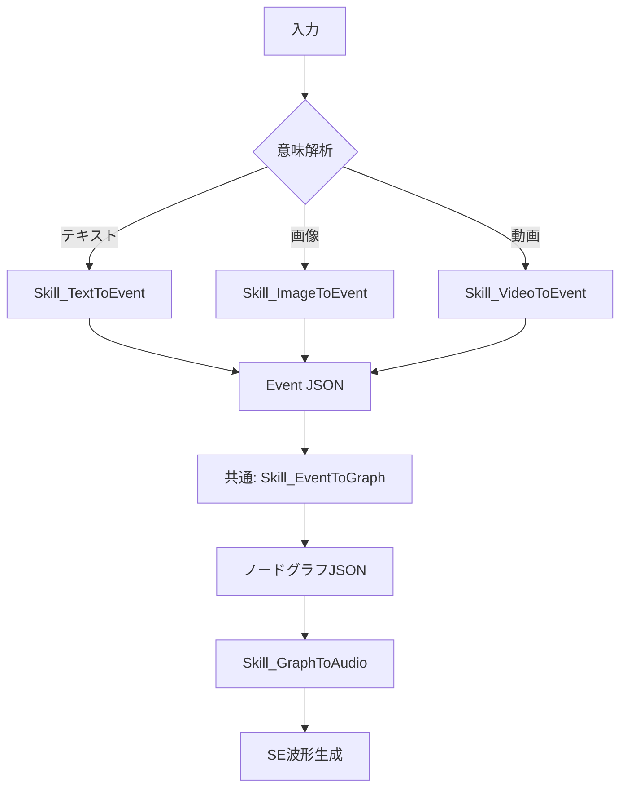

# 自然言語でのノード作成と画像解析からのノード生成Skill

Skillは分けるが、**最終的なGraph生成エンジンは共通化する**のがおすすめです。

## 推奨アーキテクチャ

あなたの構成だと、実際には

```
入力↓意味解析↓Graph生成↓SE生成
```

なので、差が出るのは「意味解析」部分だけです。



---

## Skillを分けるメリット

### ① プロンプトがシンプルになる

**自然言語の場合**

```
入力: 剣を振る音を作成
↓
出力:
```json
{
  "events": [
    {
      "name": "sword_slash",
      "intensity": 0.8
    }
  ]
}
```

**画像の場合**

```
入力: 画像を見て分析
↓
見える情報: 人物が走っている / 草地 / 雨
↓
出力:
```json
{
  "events": [
    {
      "name": "footstep_grass"
    },
    {
      "name": "rain"
    }
  ]
}
```

**必要な推論が全然違います。**

- テキスト: ユーザーの意図を直接的に理解
- 画像: Vision解析 → シーン理解 → 音響イベント推定

### ② テストしやすい

**自然言語Skillが壊れた場合**

```
入力: 爆発音
結果: 失敗
→ テキスト解析部分だけ調べればいい
```

**画像Skillが壊れた場合**

```
入力: 爆発シーンの画像
結果: 失敗
→ Vision認識部分だけ確認すればいい
```

**各Skillの責務が明確になり、デバッグが効率化します。**

### ③ 将来入力を増やしやすい

あとで以下を追加可能です：

```mermaid
graph LR
    A["Skill_TextToEvent"]
    B["Skill_ImageToEvent"]
    C["Skill_VideoToEvent"]
    D["Skill_AudioToEvent"] -->|NEW|
    E["Skill_3DSceneToEvent"] -->|NEW|
    F["Skill_GameStateToEvent"] -->|NEW|
    A --> G["共通: Skill_EventToGraph"]
    B --> G
    C --> G
    D --> G
    E --> G
    F --> G
```

新しい入力源を追加しても **Graph生成エンジンは変更不要** です。

---

## Graph生成Skillは共通化

ここは1つで十分です。**入力を統一します。**

```json
{
  "events": [
    {
      "name": "rain",
      "intensity": 0.7
    }
  ]
}
```

**Graph Builderは入力元を知る必要がありません。**

入力が

- テキスト
- 画像
- 動画

のいずれかは関係なく、**イベントJSONさえ同じフォーマット**なら同じ処理で対応できます。

---

## イベントJSONを中間言語として統一

さらにおすすめな設計：

```json
Text Skill 出力:
{
  "events": [
    {
      "type": "sword_slash"
    }
  ]
}
```

```json
Image Skill 出力:
{
  "events": [
    {
      "type": "sword_slash"
    }
  ]
}
```

```json
Video Skill 出力:
{
  "events": [
    {
      "type": "sword_slash"
    }
  ]
}
```

**Graph Builderは完全共通。**

入力元の違いを意識しません。

---

## 実装推奨構成

```
Skill_TextToEvent
    ↓
Skill_ImageToEvent
    ↓
Skill_VideoToEvent
    ↓
共通: Skill_EventToGraph
    ↓
Skill_GraphToAudio
```

つまり：

```
✅ Text→Graph と Image→Graph を別Skillにするのではなく

Text → Event
Image → Event
    ↓
共通 Event → Graph

にした方が、将来の拡張と保守が圧倒的に楽になります。
```

---

## Skill_TextToEventの設計

入力: 自然言語

```
"ファンタジー戦闘シーン。剣を3回振る。最初は強く、次第に弱くなる。背景に馬の鳴き声。"
```

処理:

1. テキスト解析（LLM）
   - アクション抽出: `sword_slash×3`
   - コンテキスト抽出: `fantasy`, `combat`
   - インテンシティ: `high→medium→low`

2. イベント列へ変換

```json
{
  "context": {
    "genre": "fantasy",
    "action": "combat"
  },
  "events": [
    {
      "type": "sword_slash",
      "intensity": 0.9,
      "index": 0
    },
    {
      "type": "sword_slash",
      "intensity": 0.6,
      "index": 1
    },
    {
      "type": "sword_slash",
      "intensity": 0.3,
      "index": 2
    },
    {
      "type": "horse_whinny",
      "intensity": 0.5
    }
  ]
}
```

---

## Skill_ImageToEventの設計

入力: 画像ファイル

```
image.png (640x480)
```

処理:

1. Vision解析（GPT-4o / Florence2）
   - シーン理解: 森、雨、人物が走っている
   - オブジェクト検出: 木、川、キャラクター

2. イベント推定

```json
{
  "context": {
    "scene": "forest",
    "weather": "rain",
    "action": "running"
  },
  "events": [
    {
      "type": "footstep_grass",
      "intensity": 0.7
    },
    {
      "type": "rain_heavy",
      "intensity": 0.6
    },
    {
      "type": "river_stream",
      "intensity": 0.4
    }
  ]
}
```

---

## Skill_VideoToEventの設計

入力: 動画ファイル

```
video.mp4 (1920x1080, 30fps, 5秒)
```

処理:

1. フレーム抽出（キーフレーム）
   - 1秒ごとに1フレーム抽出

2. 各フレームでVision解析
   - フレーム0: 人物が剣を構える
   - フレーム1: 剣を振る（開始）
   - フレーム2: 剣を振る（最高速）
   - フレーム3: 剣が戻る
   - フレーム4: 次の動作へ

3. タイムライン上のイベント生成

```json
{
  "context": {
    "scene": "duel",
    "character_action": "sword_combat"
  },
  "events": [
    {
      "type": "sword_slash",
      "intensity": 0.8,
      "timestamp": 0.5
    },
    {
      "type": "sword_impact",
      "intensity": 0.9,
      "timestamp": 1.2
    },
    {
      "type": "sword_recovery",
      "intensity": 0.3,
      "timestamp": 1.8
    }
  ]
}
```

---

## 共通: Skill_EventToGraphの設計

入力: イベントJSON

```json
{
  "context": {
    "scene": "forest"
  },
  "events": [
    {
      "type": "footstep_grass",
      "intensity": 0.7
    },
    {
      "type": "rain_heavy",
      "intensity": 0.6
    }
  ]
}
```

処理:

1. コンテキストからテンプレートを検索（RAG）
   ```
   scene="forest" → SE Template DB
   → "rain_in_forest_template"
   ```

2. イベントリストをノード化

   | event | node_type | 推奨設定 |
   |-------|-----------|--------|
   | footstep_grass | Oscillator + Envelope | freq=100-200Hz |
   | rain_heavy | NoiseGenerator + Filter | type=white noise |

3. ノードグラフへ変換（Copilot CLI）

   プロンプト:
   ```
   Events: footstep_grass, rain_heavy
   Template: rain_in_forest_template
   Generate a node graph.
   Output JSON only.
   ```

   出力:
   ```json
   {
     "nodes": [
       {
         "id": "grass_osc",
         "type": "Oscillator",
         "params": {
           "frequency": 150
         }
       },
       {
         "id": "rain_noise",
         "type": "NoiseGenerator",
         "params": {
           "type": "white"
         }
       },
       {
         "id": "mixer",
         "type": "Mixer"
       }
     ],
     "connections": [
       ["grass_osc", "mixer"],
       ["rain_noise", "mixer"]
     ]
   }
   ```

4. Rust検証

   ```rust
   match validate_graph(&graph) {
       Ok(_) => graph_is_valid,
       Err(e) => reject_and_report(e)
   }
   ```

---

## Skill_GraphToAudioの設計

入力: ノードグラフJSON + Audio Context

```json
{
  "nodes": [...],
  "connections": [...],
  "config": {
    "sample_rate": 44100,
    "duration": 5.0
  }
}
```

処理:

1. ノード順序の最適化（トポロジカルソート）

2. オーディオエンジンへ落とし込み

   ```rust
   for frame in 0..total_samples {
       output[frame] = process_graph(nodes, frame);
   }
   ```

3. WAV/MP3 エンコード

出力:

```
output.wav
```

---

## Event JSONスキーマ（統一形式）

```json
{
  "$schema": "http://json-schema.org/draft-07/schema#",
  "title": "SFX Event Schema",
  "type": "object",
  "properties": {
    "context": {
      "type": "object",
      "properties": {
        "scene": { "type": "string" },
        "genre": { "type": "string" },
        "mood": { "type": "string" },
        "source": { 
          "type": "string",
          "enum": ["text", "image", "video", "audio", "game_state"]
        }
      },
      "additionalProperties": true
    },
    "events": {
      "type": "array",
      "items": {
        "type": "object",
        "properties": {
          "type": { "type": "string" },
          "intensity": { "type": "number", "minimum": 0, "maximum": 1 },
          "timestamp": { "type": "number", "minimum": 0 },
          "index": { "type": "integer", "minimum": 0 },
          "metadata": { "type": "object" }
        },
        "required": ["type"],
        "additionalProperties": false
      }
    }
  },
  "required": ["events"]
}
```

---

## Skill間の責務分離

| Skill | 入力 | 出力 | 責務 |
|-------|------|------|------|
| TextToEvent | テキスト文字列 | Event JSON | NLU (自然言語理解) |
| ImageToEvent | 画像ファイル | Event JSON | Vision + Scene Understanding |
| VideoToEvent | 動画ファイル | Event JSON | Temporal Vision + Frame Analysis |
| EventToGraph | Event JSON | ノードグラフJSON | Graph Design (Copilot CLI) |
| GraphToAudio | ノードグラフJSON | WAV/MP3 | Audio DSP + Rendering |

---

## 長所と短所の比較

### ❌ 非推奨: 個別Skill

```
Skill_TextToGraph
Skill_ImageToGraph
Skill_VideoToGraph
```

**短所:**

- プロンプトが冗長
  ```
  "テキスト『剣の音』からノードグラフを作成"
  "画像から見た状況でノードグラフを作成"
  ```
  毎回グラフ設計を含める必要あり

- コード重複
  - Graph生成ロジックが3つのSkillに複製される

- 保守が大変
  - Graph生成の仕様を変更したら3箇所修正

---

### ✅ 推奨: 中間層を挟む

```
TextToEvent → EventToGraph
ImageToEvent → EventToGraph
VideoToEvent → EventToGraph
```

**長所:**

- 各Skillの責務が明確
  - TextToEvent: NLU のみ
  - ImageToEvent: Vision のみ
  - EventToGraph: Graph設計のみ

- テストが簡単
  ```
  Test_TextToEvent("剣を振る") → {"events": [{"type": "sword_slash"}]}
  Test_ImageToEvent(image.png) → {"events": [{"type": "sword_slash"}]}
  Test_EventToGraph(events) → ノードグラフJSON
  ```

- 拡張が容易
  ```
  新規: Skill_AudioToEvent
  既存のEventToGraphが使える
  ```

---

## KImageGraph への統合例

SFXGraph で TextToEvent / ImageToEvent を実装した後、KImageGraph でも同じ仕組みを使用できます：

```
KImageGraph:
  画像 → Skill_ImageToEvent
  → ノード自動生成
  → プレビュー

SFXGraph:
  画像 / テキスト
  → Skill_ImageToEvent / Skill_TextToEvent
  → Skill_EventToGraph
  → SE生成
```

**共有できるコンポーネント:**

- Event JSON スキーマ
- テンプレートDB (scene → event mapping)
- Copilot CLI プロンプト設計

---

## 実装ロードマップ

### Phase 1: 基礎 (Copilot CLI統合)

- [ ] Event JSON スキーマの確定
- [ ] Skill_TextToEvent の実装
- [ ] Skill_EventToGraph の実装
- [ ] Rust validation コードの実装

### Phase 2: Vision対応

- [ ] Skill_ImageToEvent の実装
- [ ] Vision API 連携 (GPT-4o / Florence2)
- [ ] テンプレートDB の構築

### Phase 3: 拡張対応

- [ ] Skill_VideoToEvent の実装
- [ ] タイムライン管理
- [ ] 複数イベントの時系列処理

### Phase 4: 高度な機能

- [ ] Skill_AudioToEvent (音声からイベント抽出)
- [ ] Skill_GameStateToEvent (ゲーム状態から自動生成)
- [ ] RAG ベースのテンプレート改善

---

## まとめ

```
✅ Event（音響イベント）を共通中間表現にする設計が最も綺麗です。

特にあなたの「画像からSEノードを自動生成する」構想なら、
この階層化が最も実装しやすく、将来の拡張と保守が圧倒的に楽になります。
```
